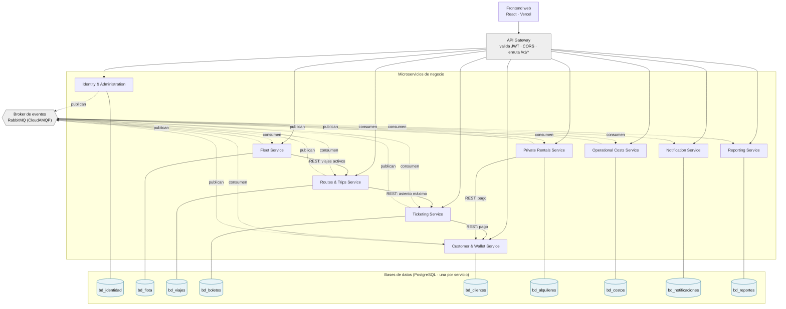

# Diagrama de arquitectura — TransportesGT

TransportesGT es una plataforma de **microservicios** para una empresa de transporte extraurbano. El frontend web
habla solo con el **API Gateway**, que valida el JWT y enruta cada prefijo `/v1/<servicio>/**` al microservicio que
corresponde. Cada microservicio es dueño de sus datos (**una base PostgreSQL por servicio**) y se comunica con los
demás de dos formas:

- **Eventos (asíncrono):** la vía principal. Cada servicio publica sus cambios en el broker con un *outbox*
  transaccional, y los demás mantienen sus propias proyecciones consumiéndolos de forma idempotente.
- **REST (síncrono):** solo donde se necesita una respuesta inmediata: cobrar en la cartera y dos validaciones
  entre servicios.

## Responsabilidades

| Servicio | Responsabilidad |
|---|---|
| Identity & Administration | Usuarios, roles, sucursales, inicio de sesión (emite el JWT) y enlaces de contraseña |
| Fleet Service | Buses y choferes: estado operativo, licencias, kilometraje y fotos |
| Routes & Trips Service | Rutas, programación de viajes y registros inmutables de salida y llegada |
| Ticketing Service | Venta de boletos en línea y en mostrador, asientos, PDF con QR y abordaje |
| Customer & Wallet Service | Perfil comercial del cliente (NIT) y cartera digital: recargas, pagos y reembolsos |
| Private Rentals Service | Solicitud, cotización, pago y seguimiento de alquileres de buses |
| Operational Costs Service | Depreciación, gastos de taller y costos de cada viaje (combustible, depreciación y salario) |
| Notification Service | Correos de confirmación, enlaces de contraseña y avisos de vencimiento de licencia |
| Reporting Service | Proyecciones de lectura y los 12 reportes (JSON y PDF con JasperReports) |

## Comunicación síncrona (REST)

| Desde | Hacia | Para qué |
|---|---|---|
| Ticketing | Customer & Wallet | Cobrar la compra en línea (`POST/GET /cartera/pagos`) |
| Private Rentals | Customer & Wallet | Cobrar el alquiler en línea (`POST/GET /cartera/pagos`) |
| Fleet | Routes & Trips | Revisar viajes activos antes de desactivar un bus o chofer (`GET /viajes/activos`) |
| Routes & Trips | Ticketing | Revisar el asiento máximo vendido antes de cambiar el bus (`asiento-maximo`) |

## Notas

- **Productores y consumidores:** Notification y Reporting solo consumen eventos. Identity solo publica.
- **Alquiler -> viaje:** Rentals y Trips se coordinan por eventos, no por REST. `AlquilerConfirmado` crea el viaje en
  Trips, y Trips responde con `ViajeProgramado/Actualizado/Eliminado` y `LlegadaRegistrada`.
- **Detalle de cada servicio:** el catálogo de eventos (`catalogo-eventos-es-v4.md`) y los manuales técnicos
  (`manual-tecnico-*.md`, con tablas, componentes y despliegue).
