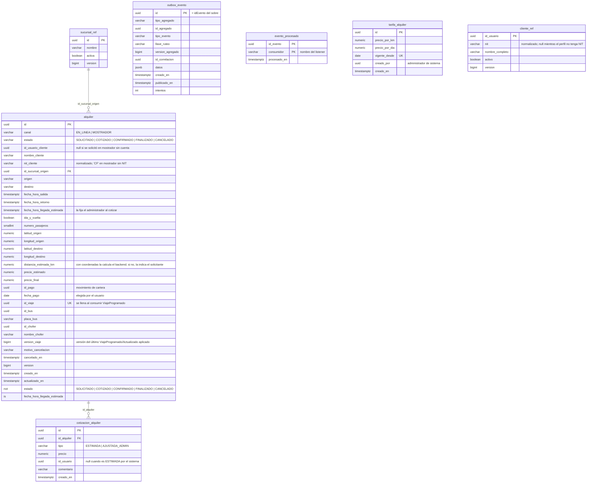
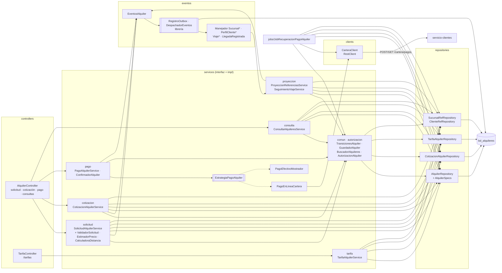
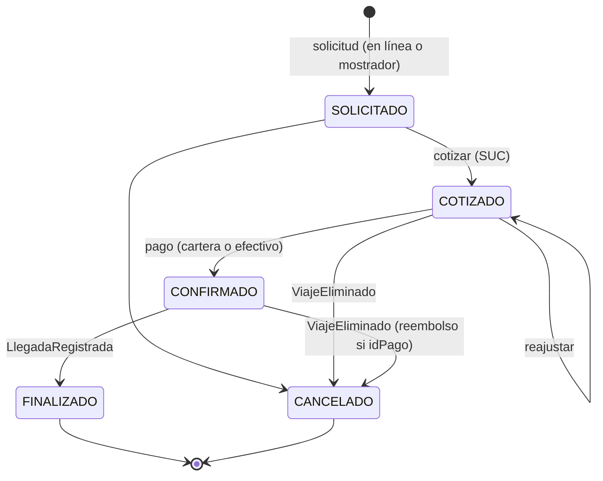
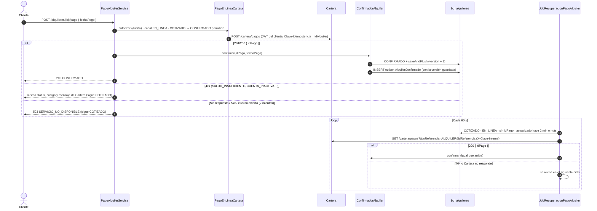
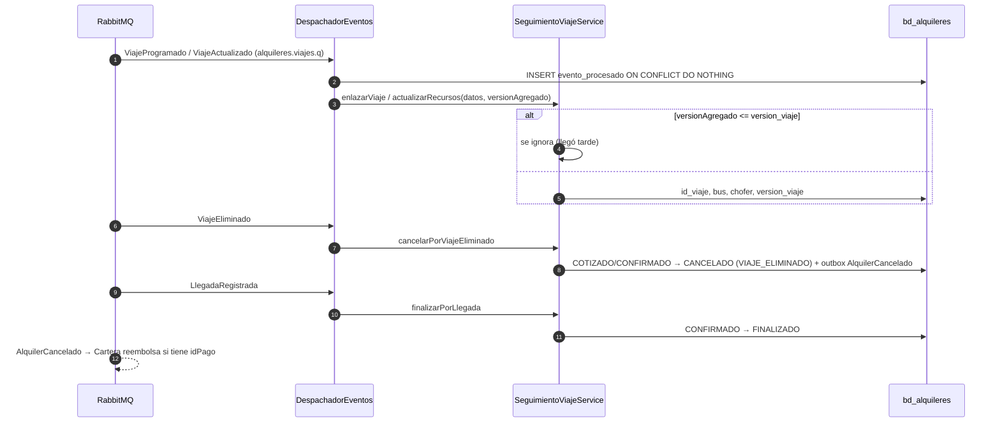
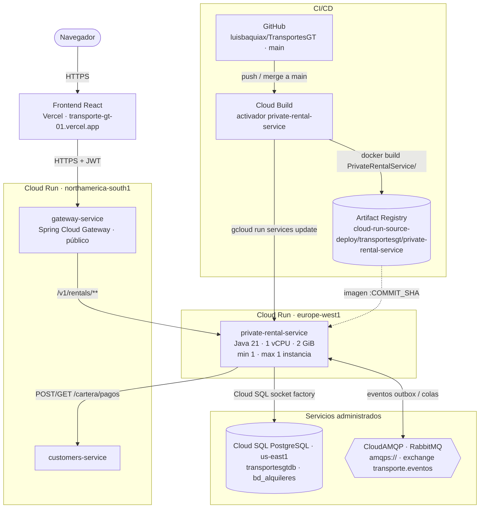

# Manual técnico — servicio-alquileres (Alquileres)

Microservicio `PrivateRentalService` de TransportesGT. Gestiona los alquileres de buses privados de punta a punta:
- la solicitud, en línea por un cliente o presencial en mostrador;
- el precio estimado, calculado con la tarifa vigente;
- la cotización del administrador de sucursal;
- el pago, con la cartera del cliente (saga con Cartera) o en efectivo en mostrador;
- el seguimiento del viaje que crea Viajes.

Fuentes de verdad: `modelo-datos-postgresql-v4.md` (tablas y reglas), `catalogo-eventos-es-v4.md` (§2.6
eventos de Alquileres, §5 contrato de pagos) y `plan-de-trabajo.md` §3.6 (endpoints).

| | |
|---|---|
| Stack | Java 21 · Spring Boot 4.1.1 · Spring Data JPA (Hibernate) · Flyway · Spring AMQP · Spring Security (resource server JWT) · RestClient + Resilience4j · MapStruct · springdoc |
| Librería de eventos | `com.github.luisbaquiax:EventosComunesTrasnportesGt:v2.1.1` (sobre, payloads, `Nit`, outbox, consumidor idempotente, topología) |
| Puerto / ruta base | `8086` / `/v1/rentals` |
| Base de datos | PostgreSQL `bd_alquileres` (usuario `svc_alquileres`) |
| Broker | RabbitMQ, exchange topic `transporte.eventos`, DLX `transporte.eventos.dlx` |

Migraciones Flyway:

| Migración | Contenido |
|---|---|
| `V1__esquema_inicial.sql` | Tablas, restricciones y trigger de transiciones |
| `V2__datos_prueba.sql` | Proyecciones de sucursales y perfiles, tarifa inicial y un alquiler en cada estado (`datos-semilla.md`) |

---

## 1. Diagrama de tablas

Las proyecciones `sucursal_ref` y `cliente_ref` se llenan con eventos y no tienen FK hacia ellas, salvo la sucursal
de origen. `cliente_ref` se consulta por `id_usuario`.

| Restricción | Garantiza |
|---|---|
| `trg_alquiler_transicion` (`fn_validar_transicion_estado`) | Solo las transiciones `SOLICITADO>COTIZADO`, `SOLICITADO>CANCELADO`, `COTIZADO>CONFIRMADO`, `COTIZADO>CANCELADO`, `CONFIRMADO>FINALIZADO` y `CONFIRMADO>CANCELADO`; el mismo estado (reajustar una cotización) no se valida |
| `ck_alquiler_coordenadas` | Las cuatro coordenadas vienen juntas o ninguna |
| `ck_alquiler_retorno` | Ida y vuelta exige un retorno posterior a la salida; solo ida no lo admite |
| `ck_alquiler_confirmado` | `CONFIRMADO`/`FINALIZADO` tienen precio final, fecha de pago y llegada estimada, y en línea también `id_pago` |
| `ck_alquiler_llegada` | La llegada estimada es posterior a la salida y, en ida y vuelta, no anterior al retorno |
| `uq_alquiler_viaje` (parcial) | Un viaje por alquiler |
| `tarifa_alquiler.vigente_desde UNIQUE` | Una tarifa por fecha de vigencia (registrar otra con la misma fecha la reemplaza) |

El servicio valida todas estas reglas antes de llegar a la base, para devolver 400, 409 o 422 con un mensaje
claro. La base es la última defensa.

---

## 2. Diagrama de componentes

| Capa | Paquete | Responsabilidad |
|---|---|---|
| Web | `controllers` | Contrato HTTP, `@Valid`, paginación `pagina`/`tamano` (`@Min`/`@Max`, máx. 100), `Location` en los 201. Solo dependen de interfaces |
| Seguridad | `config.security` | JWT, reglas gruesas por rol (`SecurityConfig`), `ConvertidorUsuarioAutenticado` (claims → `UsuarioAutenticado`) y respuestas 401/403 en JSON |
| Negocio | `services.<tema>` con su `impl` | Una interfaz por caso de uso. **solicitud**: validación, distancia (Haversine × factor de carretera) y precio estimado. **cotizacion**: precio final y llegada. **pago**: flujo común y Strategy por canal. **consulta**: detalle, listado e historial. **tarifa**: vigente, historial y registro. **proyeccion**: réplicas `_ref` y seguimiento del viaje |
| Reglas compartidas | `services.comun`, `services.autorizacion` | `TransicionesAlquiler` (mismo mapa que el trigger), `GuardadoAlquiler` (flush antes de publicar), `NormalizadorNit` (envuelve `Nit` de la librería), `CalendarioGuatemala`, `AutorizacionAlquiler` (gestión por sucursal, dueño, lectura por NIT) |
| Integración | `clients` | `CarteraClient`: 4xx → `CarteraRechazoException` con el status y código de Cartera; red, 5xx o circuito abierto → `ServicioNoDisponibleException` (503) |
| Eventos | `eventos` | Manejadores `ManejadorEvento<T>` que solo delegan, y `EventosAlquiler`, que arma los payloads con MapStruct |
| Job | `jobs` | Recuperación de pagos en línea que quedaron en duda |
| Datos | `models`, `repositories` | Entidades (`ddl-auto=validate`), `AlquilerSpecs` (filtros y visibilidad en la base) y `upsert` nativos de las proyecciones |
| Errores | `exception` | Jerarquía `AlquilerException`, `FabricaRespuestaError` y `GlobalAlquilerExceptionHandler` |

No hay métodos estáticos en las clases del servicio: los helpers son `@Component` inyectables.

### 2.1 Endpoints y permisos

| Método | Ruta | Quién | Resultado |
|---|---|---|---|
| POST | `/alquileres/solicitudes` | Autenticado con perfil y NIT | 201 `SOLICITADO` + `AlquilerSolicitado` · 422 `PERFIL_INCOMPLETO`, `COORDENADAS_*`, `SIN_TARIFA` |
| POST | `/alquileres/mostrador` | SUC, CAJ | 201. Cuerpo anidado `{ solicitud, nitCliente?, nombreCliente }`; 400 `NIT_INVALIDO` |
| POST | `/alquileres/{id}/cotizacion` | SUC de la sucursal | 200 `COTIZADO` + `AlquilerCotizado` · 409 `TRANSICION_INVALIDA` |
| POST | `/alquileres/{id}/pago` | El cliente dueño | 200 `CONFIRMADO` + `AlquilerConfirmado` · 4xx de Cartera · 503 |
| POST | `/alquileres/{id}/pago-mostrador` | SUC, CAJ de la sucursal | 200 `CONFIRMADO` (efectivo, `idPago = null`) |
| GET | `/alquileres/mios` | Autenticado | Suyos en línea y de mostrador con el NIT de su perfil |
| GET | `/alquileres?estado&desde&hasta&sinAsignar` | SUC, CAJ (su sucursal), SIS | Días de Guatemala incluidos; `sinAsignar` = `CONFIRMADO` sin bus |
| GET | `/alquileres/{id}` | SIS, personal de la sucursal, dueño, cliente con el mismo NIT | Detalle con historial de cotizaciones |
| GET | `/alquileres/tarifas/vigente?fecha` | Autenticado | 404 `SIN_TARIFA` |
| GET / POST | `/alquileres/tarifas` | SIS | Historial / registrar (reemplaza la de la misma fecha; no admite fechas pasadas) |

---

## 3. Ciclo de vida y precio estimado

**Precio estimado:**

`distancia × precioPorKm × (2 si es ida y vuelta) + días × precioPorDia`, redondeado a 2 decimales (HALF_UP).
Se calcula con la tarifa vigente hoy en Guatemala.

- **Distancia:** Haversine entre las coordenadas × `alquileres.factor-carretera` (1.3 por omisión). Sin
  coordenadas, se usa `distanciaEstimadaKm`.
- **Días:** días de calendario de Guatemala entre la salida y el retorno, ambos incluidos. Solo ida cuenta 1.

El estimado se guarda como `cotizacion_alquiler` de tipo `ESTIMADA`. Cada ajuste del administrador se guarda como
`AJUSTADA_ADMIN`.

---

## 4. Saga de pago en línea y job de recuperación

`PagoAlquilerService` sigue el mismo flujo para los dos canales; la estrategia del canal decide quién puede pagar y
cómo se cobra:

1. Carga el alquiler.
2. La estrategia autoriza.
3. Comprueba que el canal del alquiler sea el del endpoint.
4. Verifica la transición a `CONFIRMADO`.
5. La estrategia cobra.
6. `ConfirmadorAlquiler` confirma.

- **Falla cerrada:** nunca se confirma un alquiler en línea sin `idPago`; lo impide también `ck_alquiler_confirmado`.
- **Idempotencia:** Cartera no cobra dos veces el mismo alquiler, porque la clave es `idAlquiler`. Reintentar un
  503 desde el frontend es seguro.
- **Versión del evento:** `GuardadoAlquiler` hace `saveAndFlush` antes de registrar el evento. Así
  `versionAgregado` es la versión ya incrementada, y los consumidores (que descartan `version <= aplicada`) no
  pierden la confirmación.
- **Mostrador:** `PagoEfectivoMostrador` exige SUC o CAJ de la sucursal del alquiler y no llama a Cartera.

---

## 5. Eventos consumidos

| Evento | Cola | Efecto |
|---|---|---|
| `SucursalCreada` / `SucursalActualizada` | `alquileres.identidad.q` | *Upsert* de `sucursal_ref` por versión |
| `PerfilClienteActualizado` | `alquileres.cartera.q` | *Upsert* de `cliente_ref` con el NIT normalizado (habilita la solicitud en línea y el historial por NIT) |
| `ViajeProgramado` / `ViajeActualizado` | `alquileres.viajes.q` | Enlaza `id_viaje` y refleja bus y chofer; ignora las versiones viejas |
| `ViajeEliminado` | `alquileres.viajes.q` | Cancela y publica `AlquilerCancelado` |
| `LlegadaRegistrada` | `alquileres.viajes.q` | Finaliza el alquiler |

| Evento publicado | Llave | Consumidores |
|---|---|---|
| `AlquilerSolicitado` | `alquileres.alquiler.solicitado` | Notificaciones |
| `AlquilerCotizado` | `alquileres.alquiler.cotizado` | Notificaciones |
| `AlquilerConfirmado` | `alquileres.alquiler.confirmado` | Viajes (crea el viaje), Reportes, Notificaciones |
| `AlquilerCancelado` | `alquileres.alquiler.cancelado` | Clientes y Cartera (reembolso), Reportes, Notificaciones |

Error transitorio: 4 intentos (1, 2, 4 y 8 s, con un máximo de 10 s) y luego a la DLQ de su cola
(`*.dlq`). Un JSON inválido va directo a la DLQ.

---

## 6. Diagrama de despliegue

Producción en Google Cloud (proyecto `unimarketcunoc`). En local, `infra/docker-compose.yml` levanta lo mismo con
PostgreSQL y RabbitMQ en contenedores.

| Elemento | Detalle |
|---|---|
| Imagen | `Dockerfile` en dos etapas: `maven:3.9-eclipse-temurin-21` compila (`./mvnw clean package`) y `bellsoft/liberica-openjdk-alpine:21` ejecuta `app.jar` |
| CI/CD | Cada merge a `main` dispara el activador de Cloud Build: `docker build PrivateRentalService -f PrivateRentalService/Dockerfile`, push a Artifact Registry con la etiqueta del commit y `gcloud run services update private-rental-service` |
| Base de datos | Cloud SQL `unimarketcunoc:us-east1:transportesgtdb`, base `bd_alquileres`, por la *socket factory* (`jdbc:postgresql:///bd_alquileres?cloudSqlInstance=…&socketFactory=…`) |
| Configuración | Variables de entorno: `SPRING_PROFILES_DEFAULT=prod`, `SPRING_DATASOURCE_*`, `RABBITMQ_URL`, `JWT_SECRET` (el mismo de todos los servicios), `CARTERA_URL`, `CLAVE_INTERNA`, `ALQUILERES_FACTOR_CARRETERA`, `ALQUILERES_RECUPERACION_INTERVALO_MS`, `SERVER_PORT=8080`, `SWAGGER_HABILITADO`, `DB_POOL_MAX` |
| Esquema | Flyway aplica las migraciones al arrancar; Hibernate solo valida. En la nube no se modifican migraciones ya aplicadas: los cambios van en una versión nueva |
| Instancias | Exactamente 1 (`min` y `max`). Varias serían seguras: el outbox y `evento_procesado` hacen idempotente el consumo |
| CPU | Hoy con CPU solo durante peticiones (valor por defecto). Sus jobs (`@Scheduled`) y los consumidores de RabbitMQ necesitan CPU sin tráfico HTTP: conviene `--no-cpu-throttling` |
| Región | Es el único servicio en **europe-west1**; llega a Cloud SQL (us-east1) y a Cartera (northamerica-south1) por internet, igual que los demás |
| Llamadas | Cobra el pago en línea en Cartera; el job de recuperación consulta `GET /cartera/pagos` con `X-Clave-Interna` |
| Acceso | Público (`ingress=all`, sin IAM de invocación); los datos los protege el JWT. Pendiente: dejar público solo el gateway |
| Cuenta de servicio | La de Compute por defecto (`…-compute@developer.gserviceaccount.com`), compartida con los demás servicios |
| Salud | `/v1/rentals/actuator/health` (`liveness` y `readiness`) |
