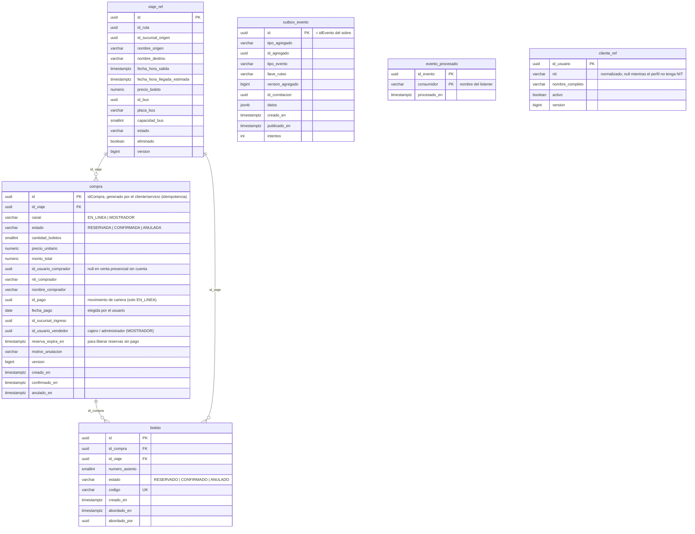
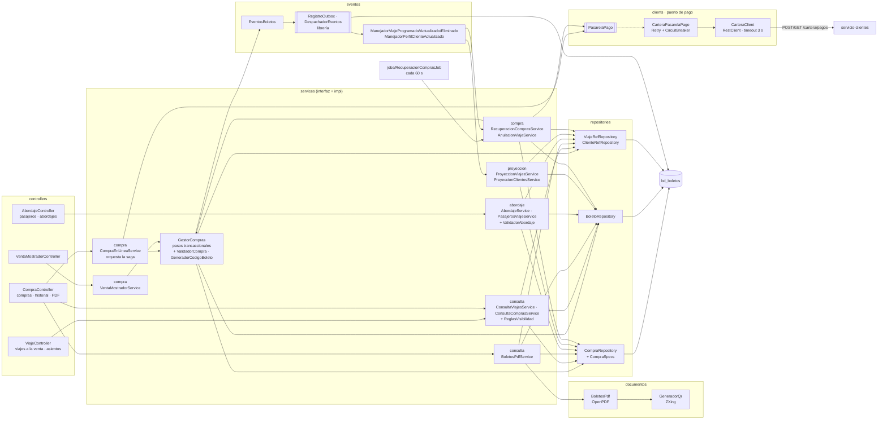
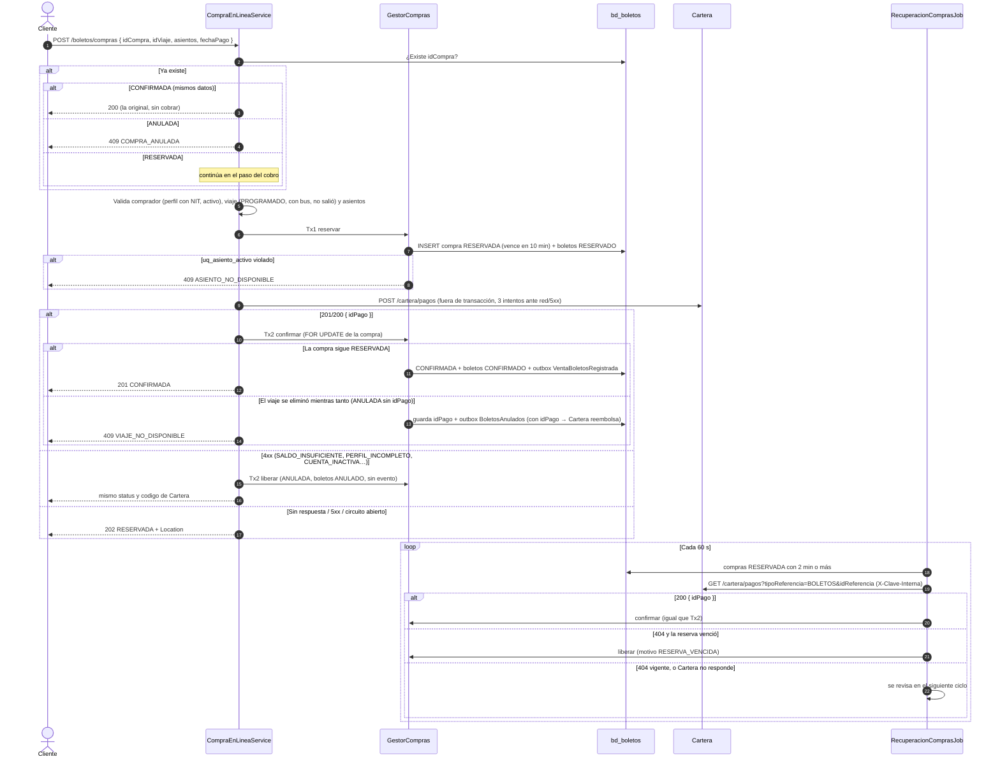
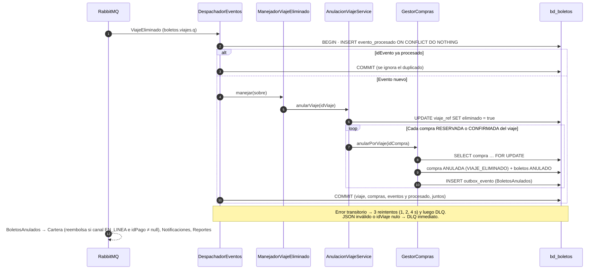
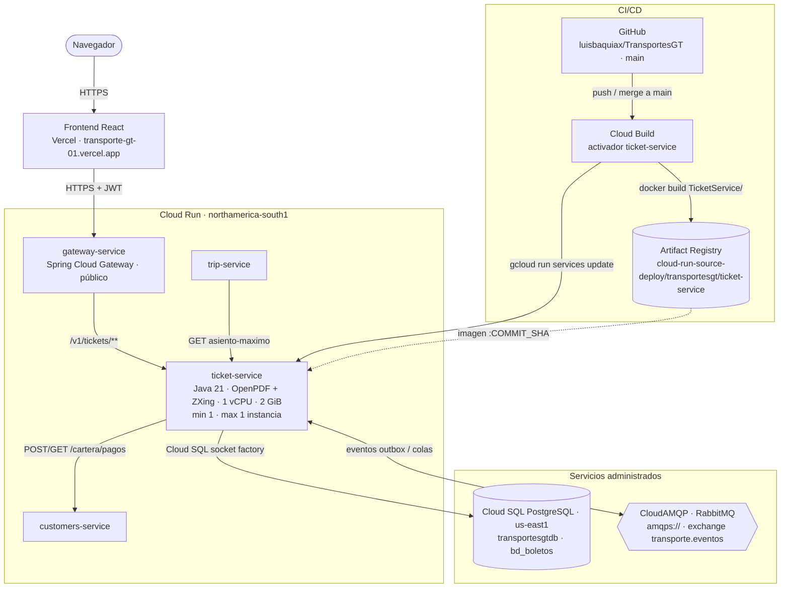

# Manual técnico — servicio-boletos (Boletos)

Microservicio `TicketService` de TransportesGT. Vende boletos de los viajes regulares: en línea, pagados con la
cartera del cliente (saga con Cartera), y en mostrador, por un cajero o administrador de sucursal. Fuentes de
verdad: `modelo-datos-postgresql-v4.md` §6 (tablas y reglas) y `catalogo-eventos-es-v4.md` (eventos de Viajes,
Cartera y Boletos, y el contrato de pagos §5).

| | |
|---|---|
| Stack | Java 21 · Spring Boot 4.1.1 · Spring Data JPA (Hibernate) · Flyway · Spring AMQP · Spring Security (resource server JWT) · RestClient + Resilience4j · springdoc |
| Librería de eventos | `com.github.luisbaquiax:EventosComunesTrasnportesGt:v2.1.1` (sobre, payloads, outbox, consumidor idempotente, topología) |
| Puerto / ruta base | `8084` / `/v1/tickets` |
| Base de datos | PostgreSQL `bd_boletos` |
| Broker | RabbitMQ, exchange topic `transporte.eventos`, DLX `transporte.eventos.dlx` |

Tablas: `viaje_ref` y `cliente_ref` (proyecciones), `compra` y `boleto` (propias), `outbox_evento` y
`evento_procesado` (librería). El índice parcial `uq_asiento_activo` y los triggers `trg_boleto_validar_asiento`,
`trg_compra_transicion` y `trg_boleto_transicion` están en `V1__esquema_inicial.sql`.

---

## 1. Diagrama de tablas

Generado de `V1__esquema_inicial.sql`. `viaje_ref` y `cliente_ref` son proyecciones de Viajes y Cartera; el índice parcial `uq_asiento_activo (id_viaje, numero_asiento)` impide vender dos veces un asiento `RESERVADO` o `CONFIRMADO`.

## 2. Diagrama de componentes

| Capa | Paquete | Responsabilidad |
|---|---|---|
| Web | `controllers` | Contrato HTTP, validación `@Valid`, códigos 200/201/202 y `Location` |
| Seguridad | `config.security` | Validar JWT, reglas por rol, `FiltroClaveInterna` |
| Negocio | `services.compra`, `services.consulta`, `services.abordaje`, `services.proyeccion` (cada uno con su `impl`) | Interfaces y su implementación, agrupadas por tema. Cada servicio vive junto a los componentes package-private que usa, para que ninguno tenga que ser público. **compra**: todo lo que cambia el estado de una compra (en línea, mostrador, recuperación y anulación por viaje); `CompraEnLineaService` orquesta la saga **sin** transacción, `GestorCompras` (bean aparte, para que el proxy de `@Transactional` aplique) hace cada paso transaccional, y `ValidadorCompra` y `GeneradorCodigoBoleto` aplican las reglas. **consulta**: viajes a la venta, mapa de asientos, historial y el PDF de los boletos, con `ReglasVisibilidad`. **abordaje**: lista de pasajeros y registro del abordaje, con `ValidadorAbordaje` (sucursal de origen, viaje `PROGRAMADO`, boleto `CONFIRMADO` del viaje). **proyeccion**: *upsert* de `viaje_ref` y `cliente_ref` desde los eventos de Viajes y Cartera (no publica eventos) |
| Integración | `clients` | `PasarelaPago` (puerto) y su adaptador `CarteraPasarelaPago`: traduce 4xx en `PagoRechazado` y fallas de red, 5xx o circuito abierto en `CarteraNoDisponible` |
| Eventos | `eventos` | Manejadores (`ManejadorEvento<T>`), validación de payloads y armado de eventos hacia el outbox |
| Job | `jobs` | Recuperación de compras `RESERVADA` |
| Datos | `models`, `repositories` | Entidades JPA (`ddl-auto=validate`), `Specification`, `upsert` nativos y `FOR UPDATE` |
| Documentos | `documentos` | `BoletosPdf` (OpenPDF) y `GeneradorQr` (ZXing): PDF de una compra con un QR por boleto |
| Errores | `exception` | Jerarquía `BoletosServiceException` y `RespuestaError` uniforme |

---

## 3. Saga de compra en línea y job de recuperación

Boletos orquesta; Cartera cobra de forma síncrona e idempotente con `Clave-Idempotencia = idCompra`. Ninguna
transacción de la base queda abierta mientras se espera a Cartera.

Puntos de diseño:

- **El índice manda.** La validación previa de asientos ocupados solo mejora el mensaje; con dos compras simultáneas
  ambas pasan la validación y el `INSERT` de la segunda viola `uq_asiento_activo`. Como esa falla aborta la
  transacción de PostgreSQL, el 409 de la carrera usa un mensaje genérico.
- **Cobro fuera de transacción.** Si el servicio cae entre el cobro y la confirmación, la compra queda `RESERVADA` y
  el job la confirma al encontrar el pago. Cartera nunca cobra dos veces la misma compra, porque la clave de
  idempotencia es `idCompra`.
- **Bloqueo de la compra.** `confirmar`, `liberar` y la anulación por viaje leen la compra con `FOR UPDATE`: el job,
  la saga y `ViajeEliminado` no pisan sus cambios.
- **Reintentos y circuito.** Retry por fuera del circuit breaker: con el circuito abierto no se reintenta y la compra
  queda `RESERVADA` de inmediato.
- **Hora.** La salida del viaje y el vencimiento de la reserva usan el `Clock` del contexto. El job selecciona por
  `reserva_expira_en` (no por `creado_en`, que pone Hibernate con la hora del sistema).

---

## 4. Eliminación de un viaje

- Las compras de mostrador también se anulan; Cartera ignora su BoletosAnulados porque no tienen pago de cartera.
- Si una compra en línea estaba `RESERVADA` sin `idPago`, su primer BoletosAnulados no genera reembolso. Si después
  llega el pago (saga o job), se publica un segundo BoletosAnulados con el `idPago`.
- Un viaje eliminado deja de listarse y su mapa de asientos responde 404.

---

## 5. Diagrama de despliegue

Producción en Google Cloud (proyecto `unimarketcunoc`). En local, `infra/docker-compose.yml` levanta lo mismo con
PostgreSQL y RabbitMQ en contenedores.

| Elemento | Detalle |
|---|---|
| Imagen | `Dockerfile` en dos etapas: `maven:3.9-eclipse-temurin-21` compila (`./mvnw clean package`) y `bellsoft/liberica-openjdk-alpine:21` ejecuta `app.jar` |
| CI/CD | Cada merge a `main` dispara el activador de Cloud Build: `docker build TicketService -f TicketService/Dockerfile`, push a Artifact Registry con la etiqueta del commit y `gcloud run services update ticket-service` |
| Base de datos | Cloud SQL `unimarketcunoc:us-east1:transportesgtdb`, base `bd_boletos`, por la *socket factory* (`jdbc:postgresql:///bd_boletos?cloudSqlInstance=…&socketFactory=…`) |
| Configuración | Variables de entorno: `SPRING_PROFILES_DEFAULT=prod`, `SPRING_DATASOURCE_*`, `RABBITMQ_URL`, `JWT_SECRET` (el mismo de todos los servicios), `CARTERA_URL`, `CLAVE_INTERNA`, `JWT_ISSUER`, `SERVER_PORT=8080`, `SWAGGER_HABILITADO`, `DB_POOL_MAX` |
| Esquema | Flyway aplica las migraciones al arrancar; Hibernate solo valida. En la nube no se modifican migraciones ya aplicadas: los cambios van en una versión nueva |
| Instancias | Exactamente 1 (`min` y `max`). Varias serían seguras: el outbox y `evento_procesado` hacen idempotente el consumo |
| CPU | Hoy con CPU solo durante peticiones (valor por defecto). Sus jobs (`@Scheduled`) y los consumidores de RabbitMQ necesitan CPU sin tráfico HTTP: conviene `--no-cpu-throttling` |
| Llamadas | Cobra en Cartera (`POST /cartera/pagos` con el JWT reenviado) y el job de recuperación consulta `GET /cartera/pagos` con `X-Clave-Interna`. Viajes le consulta `asiento-maximo` |
| PDF | OpenPDF arma el documento y ZXing el QR; no necesitan configuración ni fuentes del sistema |
| Acceso | Público (`ingress=all`, sin IAM de invocación); los datos los protege el JWT. Pendiente: dejar público solo el gateway |
| Cuenta de servicio | La de Compute por defecto (`…-compute@developer.gserviceaccount.com`), compartida con los demás servicios |
| Salud | `/v1/tickets/actuator/health` (`liveness` y `readiness`) |
