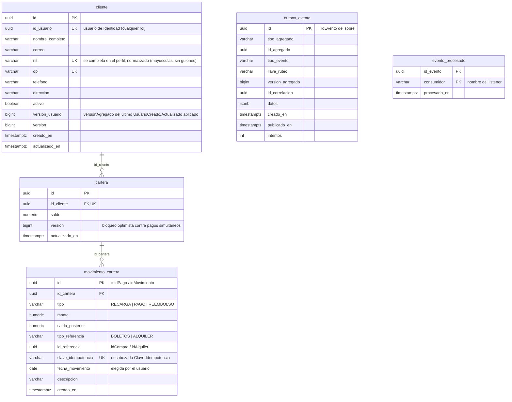
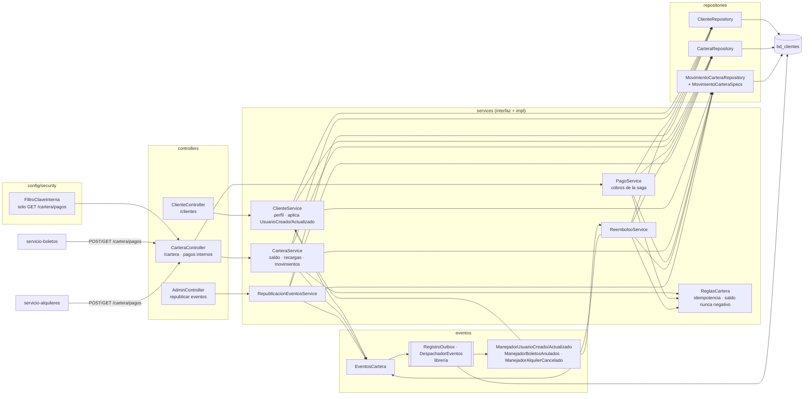
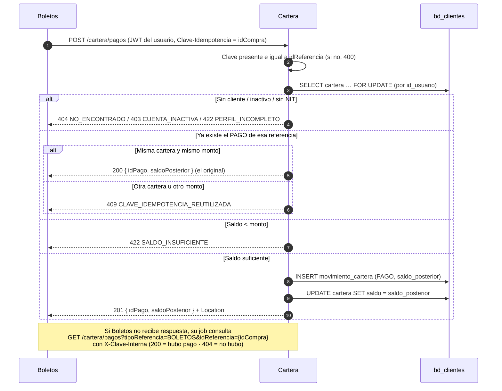
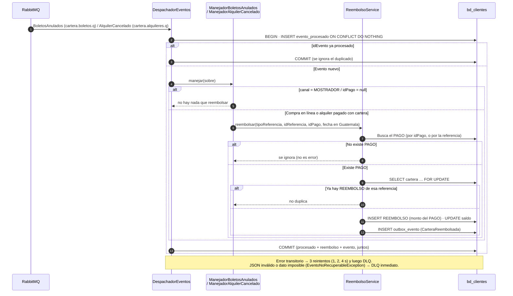
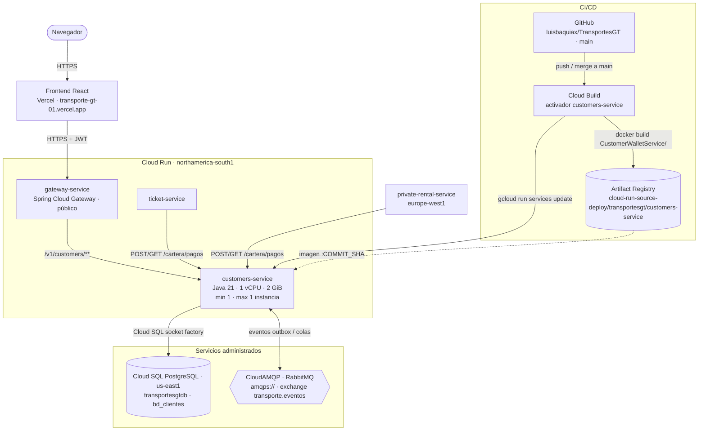

# Manual técnico — servicio-clientes (Clientes y Cartera)

Microservicio `CustomerWalletService` de TransportesGT. Mantiene el perfil comercial de **todos** los usuarios
(NIT, DPI, teléfono, dirección) y su cartera digital: recargas, cobro de compras de boletos y alquileres, y
reembolsos. Fuentes de verdad: `modelo-datos-postgresql-v4.md` §5 (tablas y reglas) y `catalogo-eventos-es-v4.md`
§2.5 y §5 (eventos y contrato de pagos).

| | |
|---|---|
| Stack | Java 21 · Spring Boot 4.1.1 · Spring Data JPA (Hibernate) · Flyway · Spring AMQP · Spring Security (resource server JWT) · springdoc |
| Librería de eventos | `com.github.luisbaquiax:EventosComunesTrasnportesGt:v2.1.1` (sobre, payloads, outbox, consumidor idempotente, topología) |
| Puerto / ruta base | `8085` / `/v1/customers` |
| Base de datos | PostgreSQL `bd_clientes` (usuario `svc_clientes`) |
| Broker | RabbitMQ, exchange topic `transporte.eventos`, DLX `transporte.eventos.dlx` |

---

## 1. Diagrama de tablas

Restricciones que protegen el dinero en la propia base:

| Restricción | Garantiza |
|---|---|
| `uq_movimiento_referencia (tipo, tipo_referencia, id_referencia) WHERE tipo IN ('PAGO','REEMBOLSO')` | Un solo cobro y un solo reembolso por compra o alquiler |
| `movimiento_cartera_clave_idempotencia_key` | Una `Clave-Idempotencia` no se aplica dos veces |
| `cartera_saldo_check` / `saldo_posterior >= 0` | El saldo nunca queda negativo (respaldo del cálculo en Java) |
| `ck_mov_referencia` | Las recargas no tienen referencia; los pagos y reembolsos sí |
| `trg_movimiento_inmutable` (`fn_bloquear_modificacion`) | El libro de movimientos no se modifica ni se elimina |
| `uq_cliente_nit`, `uq_cliente_dpi`, `cliente_nit_check` | NIT y DPI únicos; NIT con formato válido y distinto de `CF` |

---

## 2. Diagrama de componentes

| Capa | Paquete | Responsabilidad |
|---|---|---|
| Web | `controllers` | Contrato HTTP, validación `@Valid`, códigos 200/201 y `Location` |
| Seguridad | `config.security` | Validar JWT, reglas por rol, `FiltroClaveInterna` |
| Negocio | `services.impl` | Orquestan cada operación: `CarteraService` (frontend), `PagoService` (saga de Boletos y Alquileres), `ReembolsoService`, `ClienteService` y `RepublicacionEventosService` (vuelve a encolar `PerfilClienteActualizado` de todos los clientes, solo ADMIN_SISTEMA). Las reglas de dinero están en el componente `ReglasCartera`: idempotencia, cuenta activa y cambio de saldo (`acreditar` / `debitar`: nunca negativo, 2 decimales) |
| Eventos | `eventos` | Manejadores (`ManejadorEvento<T>`) y armado de payloads hacia el outbox |
| Datos | `models`, `repositories` | Entidades JPA (`ddl-auto=validate`) y consultas, incluido `FOR UPDATE` |
| Errores | `exception` | Jerarquía `CustomerWalletExcpetion` y `RespuestaError` uniforme |

---

## 3. Saga de pago (compra de boletos en línea)

Boletos orquesta la saga; Cartera hace el cobro de forma síncrona e idempotente. El usuario sale del **JWT
reenviado**, y `Clave-Idempotencia = idCompra`.

Puntos de diseño:

- **El bloqueo va en la primera lectura.** Si la cartera se leyera antes sin bloqueo, Hibernate devolvería esa copia
  (con el saldo viejo) aunque después ejecutara el `FOR UPDATE`. Con el bloqueo inicial, un segundo pago simultáneo
  espera y ve el saldo ya descontado: responde 422 y no 409.
- **Un solo chequeo de idempotencia, con el bloqueo tomado.** Otro cobro de la misma referencia espera y luego ve el
  PAGO, así que responde 200 con el original. El índice `uq_movimiento_referencia` es el respaldo.
- **El pago no publica evento:** el ingreso lo publica Boletos (`VentaBoletosRegistrada`) al confirmar la compra.
- Alquileres sigue el mismo flujo con `tipoReferencia = ALQUILER` y `Clave-Idempotencia = idAlquiler`.

---

## 4. Reembolso (eliminación de un viaje)

- El reembolso se aplica **aunque el cliente esté inactivo** (no pierde su dinero).
- `fecha_movimiento` = fecha en `America/Guatemala` de `canceladoEn` (alquiler) u `ocurridoEn` (boletos).
- Si `idPago` existe pero pertenece a otra compra o alquiler, el evento va a la DLQ: reembolsarlo devolvería el dinero
  equivocado.

---

## 5. Diagrama de despliegue

Producción en Google Cloud (proyecto `unimarketcunoc`). En local, `infra/docker-compose.yml` levanta lo mismo con
PostgreSQL y RabbitMQ en contenedores.

| Elemento | Detalle |
|---|---|
| Imagen | `Dockerfile` en dos etapas: `maven:3.9-eclipse-temurin-21` compila (`./mvnw clean package`) y `bellsoft/liberica-openjdk-alpine:21` ejecuta `app.jar` |
| CI/CD | Cada merge a `main` dispara el activador de Cloud Build: `docker build CustomerWalletService -f CustomerWalletService/Dockerfile`, push a Artifact Registry con la etiqueta del commit y `gcloud run services update customers-service` |
| Base de datos | Cloud SQL `unimarketcunoc:us-east1:transportesgtdb`, base `bd_clientes`, por la *socket factory* (`jdbc:postgresql:///bd_clientes?cloudSqlInstance=…&socketFactory=…`) |
| Configuración | Variables de entorno: `SPRING_PROFILES_DEFAULT=prod`, `SPRING_DATASOURCE_*`, `RABBITMQ_URL`, `JWT_SECRET` (el mismo de todos los servicios), `CLAVE_INTERNA`, `JWT_ISSUER`, `SERVER_PORT=8080`, `SWAGGER_HABILITADO`, `DB_POOL_MAX` |
| Esquema | Flyway aplica las migraciones al arrancar; Hibernate solo valida. En la nube no se modifican migraciones ya aplicadas: los cambios van en una versión nueva |
| Instancias | Exactamente 1 (`min` y `max`). Varias serían seguras: el outbox y `evento_procesado` hacen idempotente el consumo |
| CPU | Hoy con CPU solo durante peticiones (valor por defecto). Para que los consumidores procesen eventos sin tráfico HTTP conviene `--no-cpu-throttling` |
| Llamadas | Recibe los cobros de Boletos y Alquileres. `GET /cartera/pagos` acepta `X-Clave-Interna` para los jobs de recuperación |
| Acceso | Público (`ingress=all`, sin IAM de invocación); los datos los protege el JWT. Pendiente: dejar público solo el gateway |
| Cuenta de servicio | La de Compute por defecto (`…-compute@developer.gserviceaccount.com`), compartida con los demás servicios |
| Salud | `/v1/customers/actuator/health` (`liveness` y `readiness`) |
