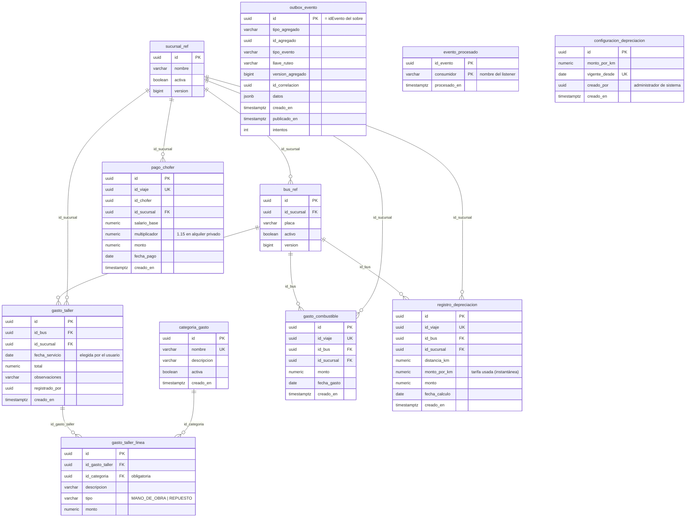
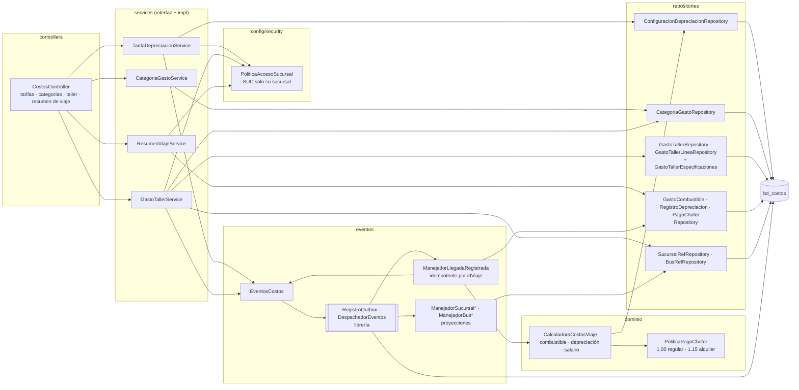
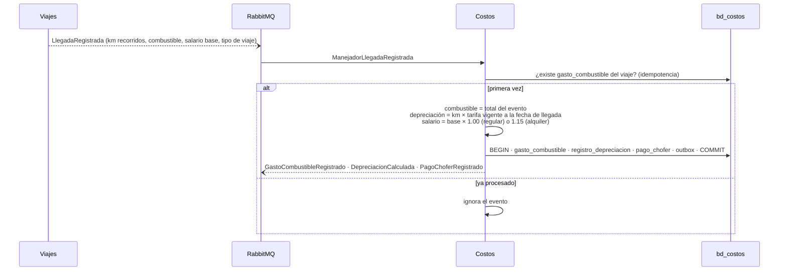
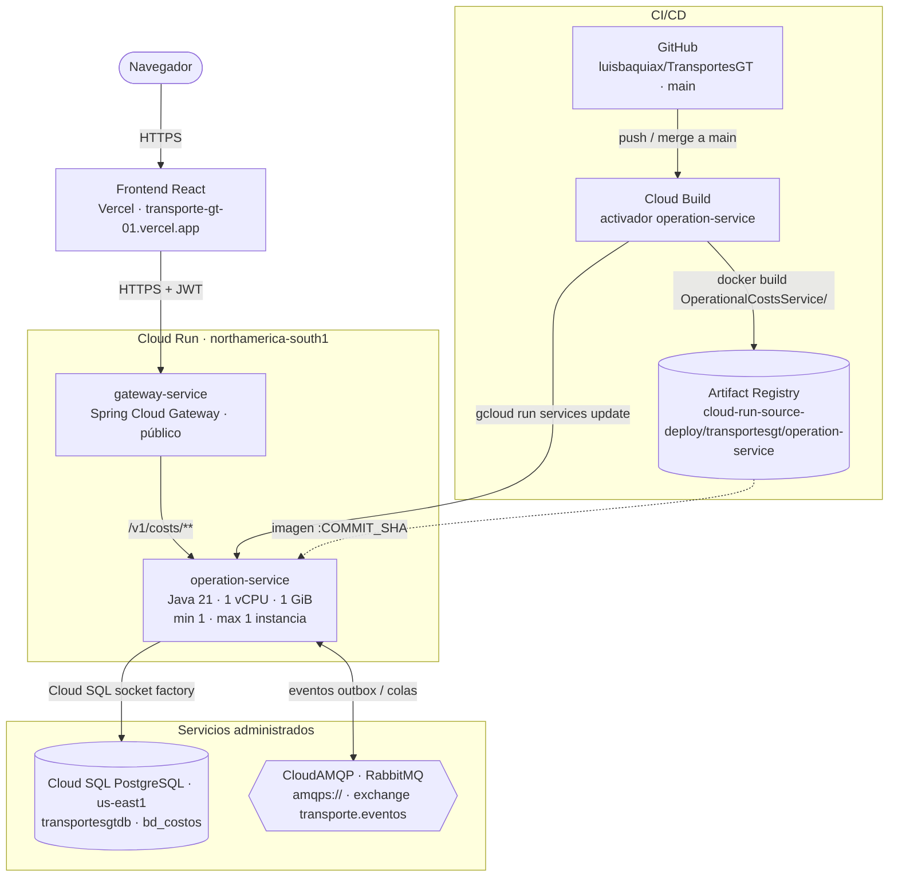

# Manual técnico — servicio-costos (Costos operativos)

Microservicio `OperationalCostsService` de TransportesGT. Registra los costos de operación:
- tarifa de depreciación por kilómetro, con historial por `vigente_desde`;
- catálogo de categorías de gasto;
- gastos de taller **inmutables** con sus líneas (repuestos y mano de obra);
- costos de cada viaje (combustible, depreciación y salario del chofer), calculados al consumir `LlegadaRegistrada`.

Fuentes de verdad: `modelo-datos-postgresql-v4.md` (tablas de Costos), `catalogo-eventos-es-v4.md` (eventos de
Costos) y el README del servicio.

| | |
|---|---|
| Stack | Java 21 · Spring Boot 4.1.1 · Spring Data JPA (Hibernate) · Flyway · Spring AMQP · Spring Security (resource server JWT) · MapStruct · springdoc |
| Librería de eventos | `com.github.luisbaquiax:EventosComunesTrasnportesGt` (sobre, payloads, outbox, consumidor idempotente) |
| Puerto / ruta base | `8087` / `/v1/costs` |
| Base de datos | PostgreSQL `bd_costos` |
| Broker | RabbitMQ, exchange topic `transporte.eventos`, DLX `transporte.eventos.dlx` |

---

## 1. Diagrama de tablas

Generado de `V1__esquema_inicial.sql`. `sucursal_ref` y `bus_ref` son proyecciones de Identidad y Flota. `gasto_taller` y sus líneas no se modifican: un trigger diferido exige que el total sea la suma de las líneas.

## 2. Diagrama de componentes

- Un servicio por subdominio (`TarifaDepreciacionService`, `CategoriaGastoService`, `GastoTallerService`,
  `ResumenViajeService`) con su implementación en `impl/`; el controlador inyecta cada uno.
- Las fórmulas viven en `dominio/`: `CalculadoraCostosViaje` y `PoliticaPagoChofer` (multiplicadores 1.00 y 1.15).
- `PoliticaAccesoSucursal` aplica la regla de sucursal: el administrador de sucursal solo ve y registra lo suyo.

## 3. Costos de un viaje

Si no hay tarifa vigente a la fecha de llegada, el evento falla con `SIN_TARIFA` y se reintenta; cambiar la tarifa no
altera los costos ya calculados.

## 4. Diagrama de despliegue

Producción en Google Cloud (proyecto `unimarketcunoc`). En local, `infra/docker-compose.yml` levanta lo mismo con
PostgreSQL y RabbitMQ en contenedores.

| Elemento | Detalle |
|---|---|
| Imagen | `Dockerfile` en dos etapas: `maven:3.9-eclipse-temurin-21` compila (`./mvnw clean package`) y `bellsoft/liberica-openjdk-alpine:21` ejecuta `app.jar` |
| CI/CD | Cada merge a `main` dispara el activador de Cloud Build: `docker build OperationalCostsService -f OperationalCostsService/Dockerfile`, push a Artifact Registry con la etiqueta del commit y `gcloud run services update operation-service` |
| Base de datos | Cloud SQL `unimarketcunoc:us-east1:transportesgtdb`, base `bd_costos`, por la *socket factory* (`jdbc:postgresql:///bd_costos?cloudSqlInstance=…&socketFactory=…`) |
| Configuración | Variables de entorno: `SPRING_PROFILES_DEFAULT=prod`, `SPRING_DATASOURCE_*`, `RABBITMQ_URL`, `JWT_SECRET` (el mismo de todos los servicios), `SERVER_PORT=8080`, `SWAGGER_HABILITADO`, `DB_POOL_MAX` |
| Esquema | Flyway aplica las migraciones al arrancar; Hibernate solo valida. En la nube no se modifican migraciones ya aplicadas: los cambios van en una versión nueva |
| Instancias | Exactamente 1 (`min` y `max`). Varias serían seguras: el outbox y `evento_procesado` hacen idempotente el consumo |
| CPU | Hoy con CPU solo durante peticiones (valor por defecto). Para que los consumidores procesen eventos sin tráfico HTTP conviene `--no-cpu-throttling` |
| Eventos | Consume `SucursalCreada/Actualizada`, `BusRegistrado/Actualizado` y `LlegadaRegistrada`; publica `GastoCombustibleRegistrado`, `DepreciacionCalculada`, `PagoChoferRegistrado`, `GastoTallerRegistrado` y `TarifaDepreciacionCambiada`. No llama a otros servicios |
| Acceso | Público (`ingress=all`, sin IAM de invocación); los datos los protege el JWT. Pendiente: dejar público solo el gateway |
| Cuenta de servicio | La de Compute por defecto (`…-compute@developer.gserviceaccount.com`), compartida con los demás servicios |
| Salud | `/v1/costs/actuator/health` (`liveness` y `readiness`) |
