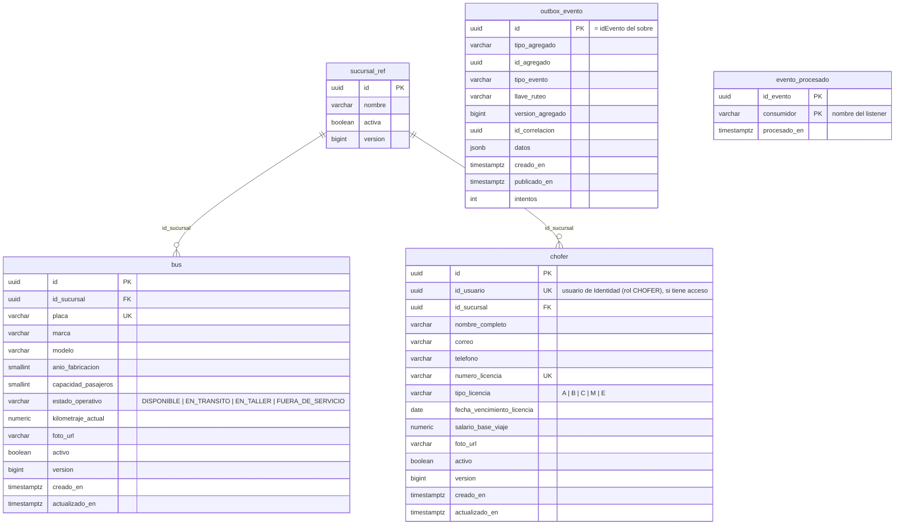
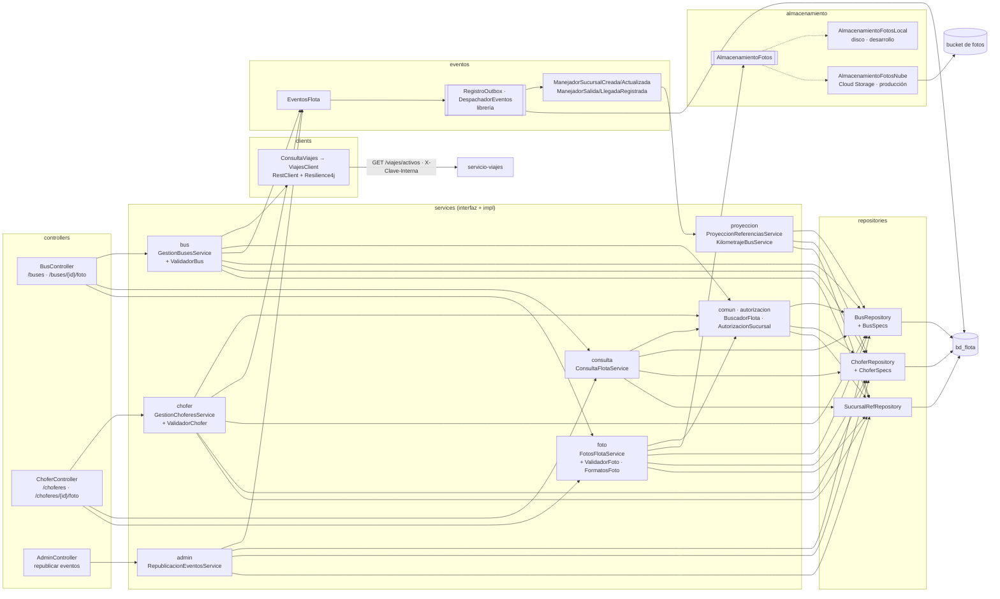
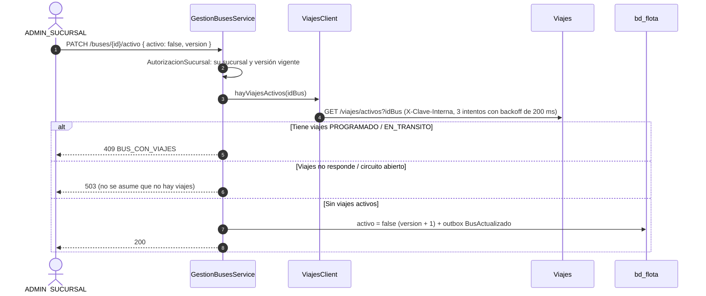
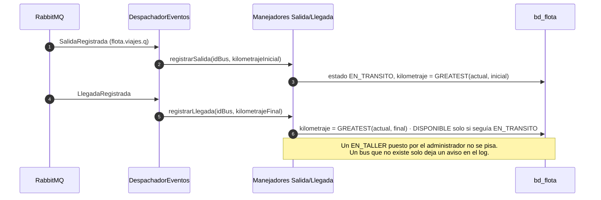
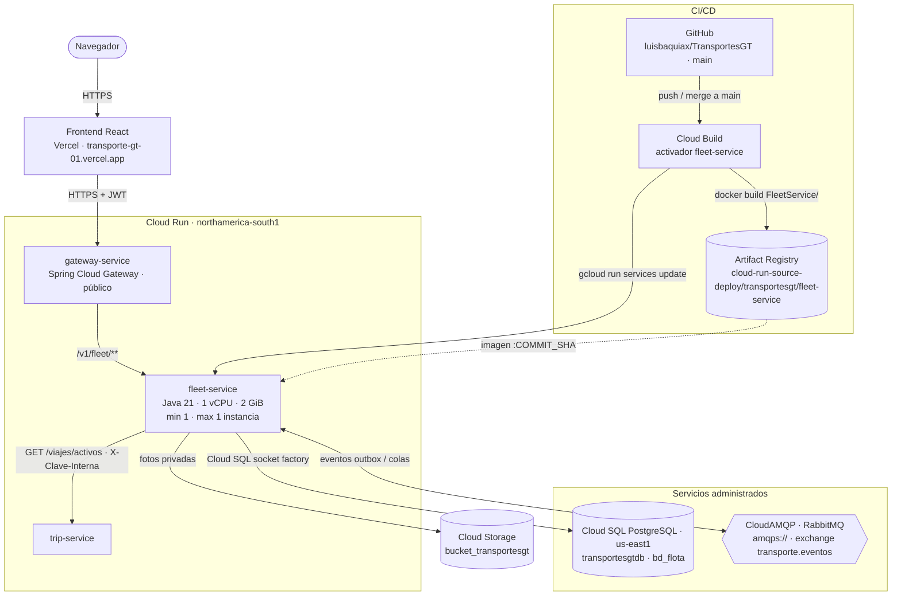

# Manual técnico — servicio-flota (Flota)

Microservicio `FleetService` de TransportesGT. Es la fuente de verdad de los **buses** y los **choferes** de cada
sucursal:
- alta, edición y desactivación (nunca se eliminan);
- estado operativo del bus;
- licencia y salario base del chofer;
- fotos privadas de buses y choferes;
- kilometraje, que se actualiza con la salida y la llegada de los viajes.

| | |
|---|---|
| Stack | Java 21 · Spring Boot 4.1.1 · Spring Data JPA (Hibernate) · Flyway · Spring AMQP · Spring Security (resource server JWT) · RestClient + Resilience4j · MapStruct · springdoc · Google Cloud Storage (opcional) |
| Librería de eventos | `com.github.luisbaquiax:EventosComunesTrasnportesGt:v2.1.1` |
| Puerto / ruta base | `8082` / `/v1/fleet` |
| Base de datos | PostgreSQL `bd_flota` (usuario `svc_flota`) |
| Broker | RabbitMQ, exchange topic `transporte.eventos`, DLX `transporte.eventos.dlx` |

Migraciones Flyway:

| Migración | Contenido |
|---|---|
| `V1__esquema_inicial.sql` | Tablas, índices y triggers |
| `V2__datos_prueba.sql` | 3 sucursales, 9 buses (`b000…001-009`) y 9 choferes (`c000…001-009`; los nueve enlazados a su usuario CHOFER, `…041`–`…049`). Los demás servicios traen sus proyecciones en su propia V2 (`datos-semilla.md`) |

---

## 1. Diagrama de tablas

| Restricción | Garantiza |
|---|---|
| `uq_bus_placa` sobre `upper(placa)` | Una placa por bus, sin importar mayúsculas |
| `chofer.numero_licencia UNIQUE`, `chofer.id_usuario UNIQUE` | Una licencia por chofer y un usuario de Identidad por chofer |
| `trg_bus_sin_delete`, `trg_chofer_sin_delete` (`fn_bloquear_eliminacion`) | Los buses y choferes no se eliminan: solo se desactivan |
| `CHECK` de estado operativo, año, capacidad, kilometraje, tipo de licencia y salario | Valores válidos aunque se escriba fuera del servicio |
| `idx_chofer_vencimiento` (parcial, activos) | Consultas de licencias por vencer |

---

## 2. Diagrama de componentes

| Capa | Paquete | Responsabilidad |
|---|---|---|
| Web | `controllers` | Contrato HTTP, `@Valid`, paginación de Spring (`page`/`size`), subida `multipart` de fotos. Solo dependen de interfaces |
| Seguridad | `config.security` | JWT, reglas por rol (lectura SIS y SUC; escritura solo SUC; `/admin/**` solo SIS) y `ConvertidorUsuarioAutenticado` (claims → `UsuarioAutenticado`) |
| Negocio | `services.<tema>` con su `impl` | Una interfaz por caso de uso y sus validadores package-private. **bus** y **chofer**: alta, edición, activo y estado operativo (`ValidadorBus`: placa única, `EN_TRANSITO` solo por evento; `ValidadorChofer`: licencia y usuario únicos). **consulta**: listados y detalle con la visibilidad por sucursal. **foto**: guardar y leer las fotos privadas (`ValidadorFoto`, `FormatosFoto`). **proyeccion**: `sucursal_ref` y kilometraje por salida y llegada. **admin**: republicar eventos |
| Reglas compartidas | `services.autorizacion`, `services.comun` | `AutorizacionSucursal` (el SUC solo gestiona su sucursal; la sucursal debe existir y estar activa; versión optimista) y `BuscadorFlota` (404 de bus o chofer) |
| Fotos | `almacenamiento` | Puerto `AlmacenamientoFotos` (Strategy): disco local en desarrollo o Cloud Storage con `FOTOS_NUBE_HABILITADA=true` (`@ConditionalOnProperty`). Clave `{buses|choferes}/{id}.{ext}`; JPEG, PNG o WebP de hasta 5 MB |
| Integración | `clients` | `ConsultaViajes` (DIP) y `ViajesClient`: antes de desactivar un bus pregunta a Viajes si tiene viajes `PROGRAMADO` o `EN_TRANSITO`. Falla cerrada: si Viajes no responde, 503 |
| Eventos | `eventos` | `EventosFlota` publica `Bus*`/`Chofer*` con la versión ya guardada (`saveAndFlush`); los manejadores solo delegan |
| Datos | `models`, `repositories` | Entidades (`ddl-auto=validate`), `BusSpecs`/`ChoferSpecs` (`@Component`), *upsert* de `sucursal_ref` y `UPDATE` nativos de kilometraje |
| Errores | `exception` | Jerarquía `FlotaException`, `GlobalFlotaExceptionHandler`, `FabricaRespuestaError` y `TraductorErroresBd` (mensajes de únicos y triggers de PostgreSQL) |

No hay métodos estáticos en las clases del servicio: los helpers son `@Component` inyectables.

### 2.1 Endpoints y permisos

| Método | Ruta | Quién | Notas |
|---|---|---|---|
| GET | `/buses?idSucursal&estadoOperativo&activo&texto` y `/buses/{id}` | SIS, SUC (su sucursal) | Paginado |
| POST / PUT | `/buses`, `/buses/{id}` | SUC | 409 placa duplicada; `version` para el control optimista. Publica `BusRegistrado` / `BusActualizado` |
| PATCH | `/buses/{id}/activo` | SUC | Desactivar consulta a Viajes: 409 si tiene viajes activos, 503 si Viajes no responde |
| PATCH | `/buses/{id}/estado-operativo` | SUC | `DISPONIBLE`, `EN_TALLER` o `FUERA_DE_SERVICIO` (`EN_TRANSITO` solo por evento) |
| GET / POST | `/buses/{id}/foto` | Lectura SIS y SUC; subida SUC | Foto privada, servida por el propio servicio |
| GET | `/choferes?idSucursal&activo&texto` y `/choferes/{id}` | SIS, SUC | Paginado |
| POST / PUT / PATCH | `/choferes`, `/choferes/{id}`, `/choferes/{id}/activo` | SUC | 409 licencia duplicada o usuario ya enlazado. Publica `ChoferRegistrado` / `ChoferActualizado` |
| GET / POST | `/choferes/{id}/foto` | Lectura SIS y SUC; subida SUC | Foto privada |
| POST | `/admin/republicar-eventos` | SIS | Republica `BusRegistrado` y `ChoferRegistrado` de todo lo existente (idempotente) |

Un cambio que no altera nada (activar un bus ya activo, poner el mismo estado) no publica evento.

---

## 3. Desactivación de un bus

---

## 4. Kilometraje y estado por los viajes

| Evento consumido | Cola | Efecto |
|---|---|---|
| `SucursalCreada` / `SucursalActualizada` | `flota.identidad.q` | *Upsert* de `sucursal_ref` por versión (la sucursal debe estar activa para registrar buses y choferes) |
| `SalidaRegistrada` | `flota.viajes.q` | Bus `EN_TRANSITO` y kilometraje inicial |
| `LlegadaRegistrada` | `flota.viajes.q` | Kilometraje final y vuelta a `DISPONIBLE` |

| Evento publicado | Llave | Consumidores |
|---|---|---|
| `BusRegistrado` / `BusActualizado` | `flota.bus.registrado` / `flota.bus.actualizado` | Viajes, Costos, Reportes |
| `ChoferRegistrado` / `ChoferActualizado` | `flota.chofer.registrado` / `flota.chofer.actualizado` | Viajes, Notificaciones, Reportes |

Los eventos son instantáneas completas y llevan la versión del registro, de modo que un consumidor descarta las
que llegan fuera de orden.

---

## 5. Fotos privadas

- El SUC sube la foto con `POST /buses/{id}/foto` o `/choferes/{id}/foto` (campo `archivo`). Se valida el tipo
  (JPEG, PNG o WebP) y el tamaño (`FOTOS_TAMANIO_MAXIMO_BYTES`, 5 MB). Se guarda con la clave
  `{tipo}/{id}.{ext}` y se reemplaza la anterior.
- La lectura pasa por el servicio (`GET /buses/{id}/foto`) con la misma autorización que el registro. Así las fotos
  no quedan públicas ni se saltan el gateway. El frontend las pide con el JWT y las muestra como `blob:`.
- Al subir una foto se toca `actualizado_en` para forzar una versión nueva aunque la clave no cambie. El frontend
  agrega `?v={version}` y evita la caché.
- En producción se habilita `FOTOS_NUBE_HABILITADA=true` con `FOTOS_NUBE_BUCKET`, porque el disco de Cloud Run es
  efímero.

---

## 6. Diagrama de despliegue

Producción en Google Cloud (proyecto `unimarketcunoc`). En local, `infra/docker-compose.yml` levanta lo mismo con
PostgreSQL y RabbitMQ en contenedores.

| Elemento | Detalle |
|---|---|
| Imagen | `Dockerfile` en dos etapas: `maven:3.9-eclipse-temurin-21` compila (`./mvnw clean package`) y `bellsoft/liberica-openjdk-alpine:21` ejecuta `app.jar` |
| CI/CD | Cada merge a `main` dispara el activador de Cloud Build: `docker build FleetService -f FleetService/Dockerfile`, push a Artifact Registry con la etiqueta del commit y `gcloud run services update fleet-service` |
| Base de datos | Cloud SQL `unimarketcunoc:us-east1:transportesgtdb`, base `bd_flota`, por la *socket factory* (`jdbc:postgresql:///bd_flota?cloudSqlInstance=…&socketFactory=…`) |
| Configuración | Variables de entorno: `SPRING_PROFILES_DEFAULT=prod`, `SPRING_DATASOURCE_*`, `RABBITMQ_URL`, `JWT_SECRET` (el mismo de todos los servicios), `VIAJES_URL`, `CLAVE_INTERNA`, `FOTOS_NUBE_HABILITADA=true`, `FOTOS_NUBE_BUCKET`, `FOTOS_DIRECTORIO`, `FOTOS_TAMANIO_MAXIMO_BYTES`, `SERVER_PORT=8080`, `SWAGGER_HABILITADO`, `DB_POOL_MAX` |
| Esquema | Flyway aplica las migraciones al arrancar; Hibernate solo valida. En la nube no se modifican migraciones ya aplicadas: los cambios van en una versión nueva |
| Instancias | Exactamente 1 (`min` y `max`). Varias serían seguras: el outbox y `evento_procesado` hacen idempotente el consumo |
| CPU | Hoy con CPU solo durante peticiones (valor por defecto). Para que los consumidores procesen eventos sin tráfico HTTP conviene `--no-cpu-throttling` |
| Fotos | Bucket privado `bucket_transportesgt` (acceso uniforme, sin `allUsers`). La cuenta de servicio tiene `roles/storage.objectAdmin` sobre el bucket: crea, lee, lista y borra. `foto_url` guarda la clave (`buses/{id}.jpg`) y el frontend las lee por `GET /{id}/foto` con el JWT |
| Llamadas | Antes de desactivar un bus o chofer consulta `GET /viajes/activos` a Viajes (RestClient + Resilience4j, `X-Clave-Interna`) |
| Acceso | Público (`ingress=all`, sin IAM de invocación); los datos los protege el JWT. Pendiente: dejar público solo el gateway |
| Cuenta de servicio | La de Compute por defecto (`…-compute@developer.gserviceaccount.com`), compartida con los demás servicios |
| Salud | `/v1/fleet/actuator/health` (`liveness` y `readiness`) |
