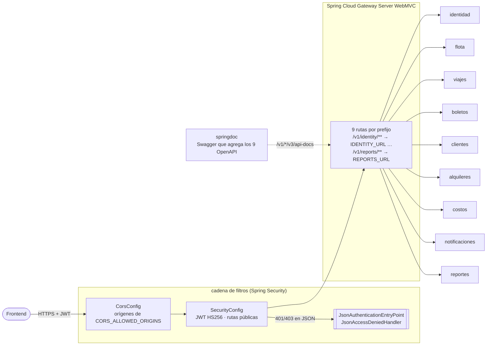
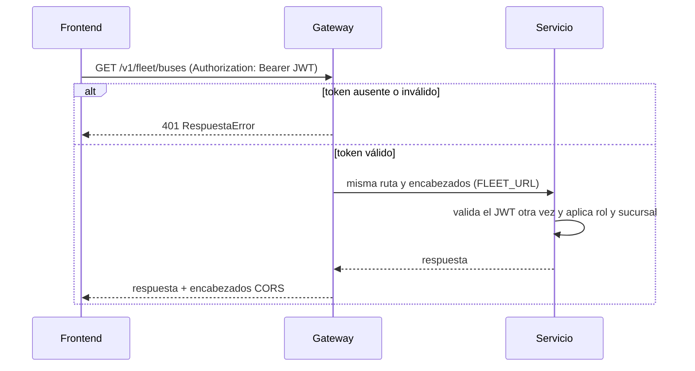
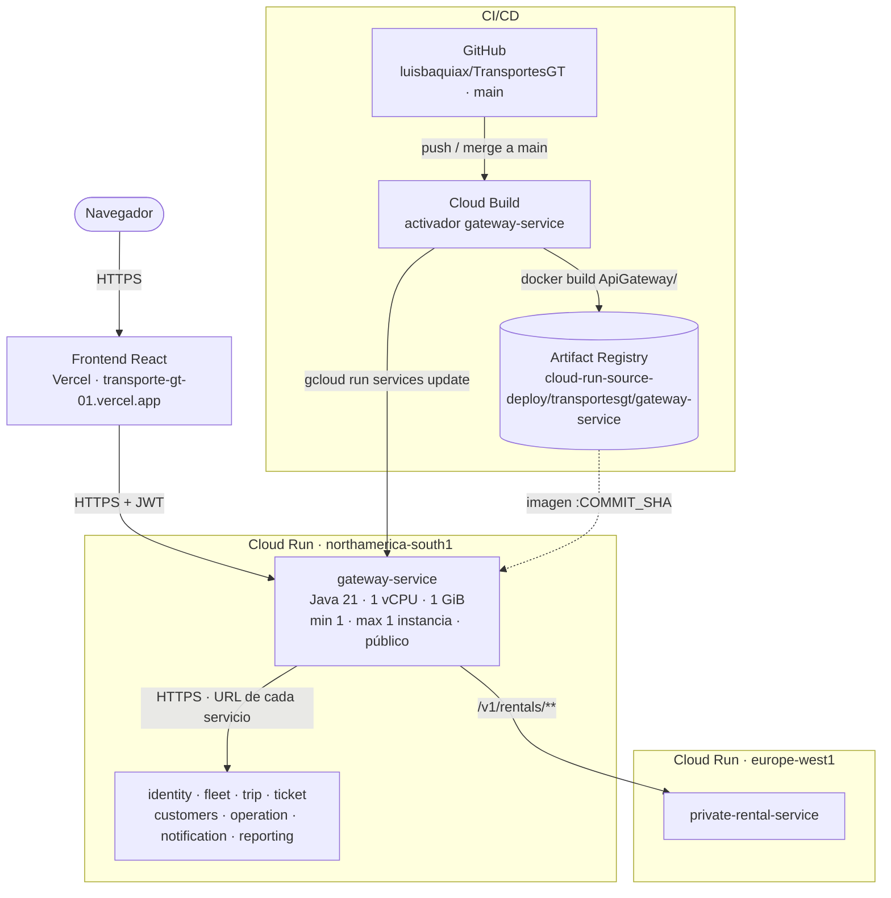

# Manual técnico — api-gateway (Gateway)

Microservicio `ApiGateway` de TransportesGT. Es la **única puerta de entrada** del frontend:
- enruta cada prefijo `/v1/<servicio>/**` al microservicio correspondiente, sin reescribir la ruta;
- valida el JWT (HS256) antes de reenviar, salvo en las rutas públicas;
- centraliza CORS (los microservicios no lo configuran);
- publica un Swagger que agrega la documentación de los 9 servicios.

No tiene base de datos ni usa RabbitMQ.

| | |
|---|---|
| Stack | Java 21 · Spring Boot 4.1.1 · Spring Cloud Gateway Server WebMVC · Spring Security (resource server JWT) · springdoc |
| Puerto | `8080` |
| Configuración | `JWT_SECRET`, `CORS_ALLOWED_ORIGINS` y una URL por servicio (`IDENTITY_URL`, `FLEET_URL`, `TRIPS_URL`, `TICKETS_URL`, `CUSTOMERS_URL`, `RENTALS_URL`, `COSTS_URL`, `NOTIFICATIONS_URL`, `REPORTS_URL`) |

---

## 1. Diagrama de componentes

- `SecurityConfig` decodifica el JWT con el mismo secreto que usa Identidad para firmarlo y convierte el claim `rol`
  en `ROLE_<rol>`. El gateway solo exige que el token sea válido; las reglas por rol y sucursal las aplica cada servicio.
- Las respuestas 401 y 403 salen en el mismo formato `RespuestaError` que los servicios.

## 2. Enrutamiento

| Prefijo | Variable | Servicio | Local |
|---|---|---|---|
| `/v1/identity/**` | `IDENTITY_URL` | identity-service | `:8081` |
| `/v1/fleet/**` | `FLEET_URL` | fleet-service | `:8082` |
| `/v1/trips/**` | `TRIPS_URL` | trip-service | `:8083` |
| `/v1/tickets/**` | `TICKETS_URL` | ticket-service | `:8084` |
| `/v1/customers/**` | `CUSTOMERS_URL` | customers-service | `:8085` |
| `/v1/rentals/**` | `RENTALS_URL` | private-rental-service | `:8086` |
| `/v1/costs/**` | `COSTS_URL` | operation-service | `:8087` |
| `/v1/notifications/**` | `NOTIFICATIONS_URL` | notification-service | `:8088` |
| `/v1/reports/**` | `REPORTS_URL` | reporting-service | `:8089` |

Rutas públicas (sin JWT): `/v1/identity/auth/**`, `/v1/identity/registration/**`, Swagger (`/swagger-ui/**`,
`/v3/api-docs/**`, `/v1/*/v3/api-docs/**`), `/actuator/health/**` y todos los `OPTIONS` (preflight de CORS).

## 3. Diagrama de despliegue

| Elemento | Detalle |
|---|---|
| Imagen | `Dockerfile` en dos etapas: `maven:3.9-eclipse-temurin-21` compila y `bellsoft/liberica-openjdk-alpine:21` ejecuta `app.jar` |
| CI/CD | Cada merge a `main` dispara el activador de Cloud Build: `docker build ApiGateway -f ApiGateway/Dockerfile`, push a Artifact Registry y `gcloud run services update gateway-service` |
| Configuración | Variables de entorno: `JWT_SECRET` (el mismo de todos los servicios), `CORS_ALLOWED_ORIGINS` (incluye el dominio de Vercel), `SERVER_PORT=8080` y las 9 `*_URL` con las URL de Cloud Run de cada servicio |
| Instancias | 1 (`min` y `max`), 1 vCPU y 1 GiB. Sin estado: puede escalar a más instancias sin cambios |
| Multipart | Reenvía `multipart/form-data` sin tocar el cuerpo (subida de fotos de Flota) |
| Acceso | Público: es la única entrada prevista. Los servicios de atrás hoy también son públicos; el plan es exigir IAM de invocación y que el gateway envíe un token de identidad de Google |
| Salud | `/actuator/health` |
