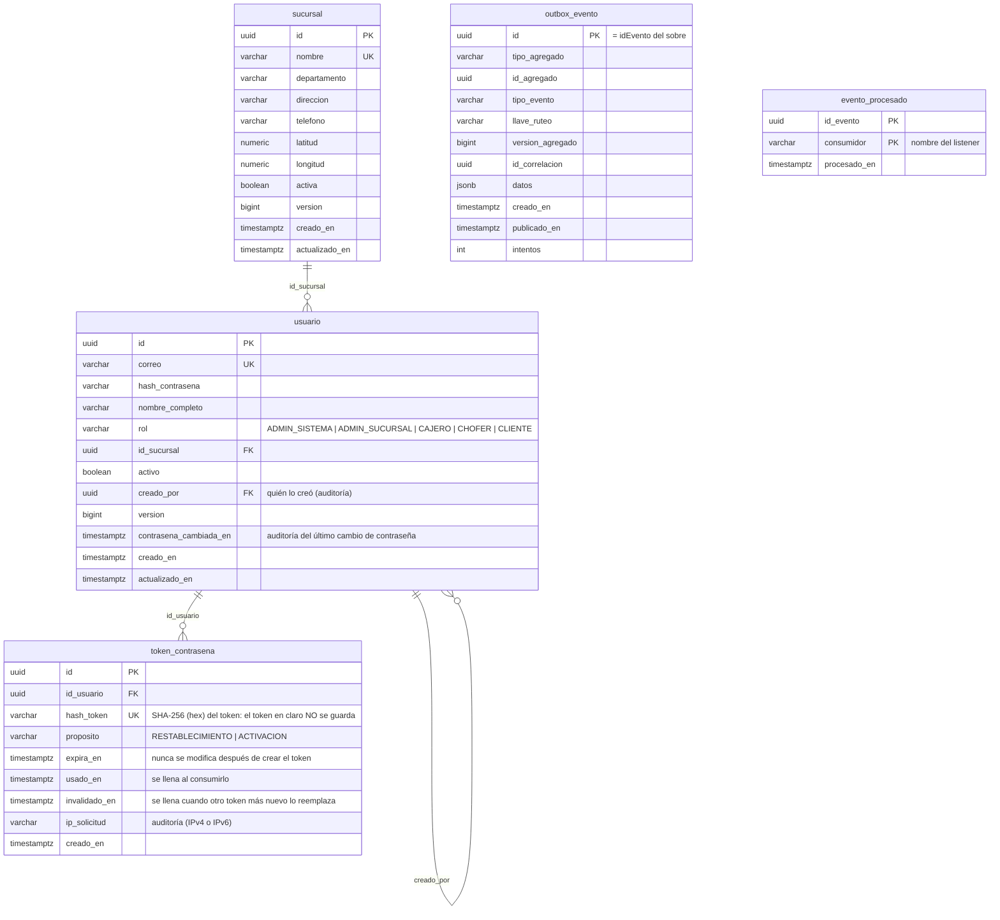
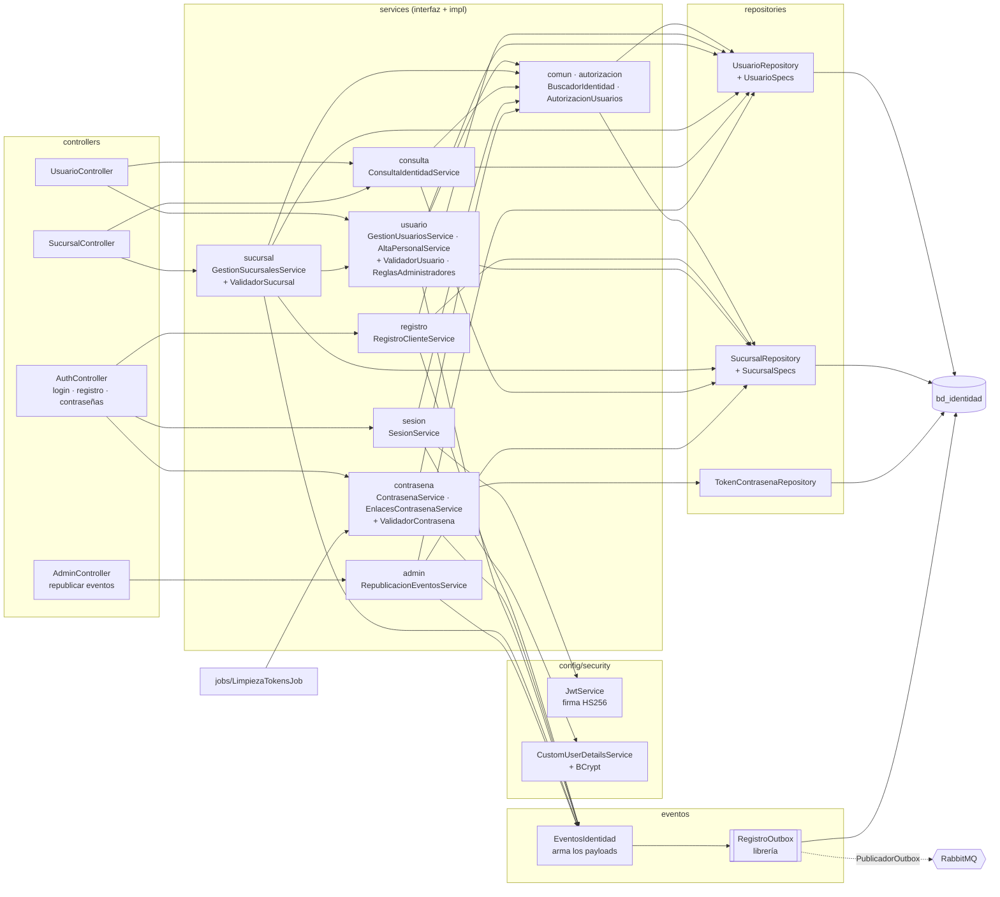
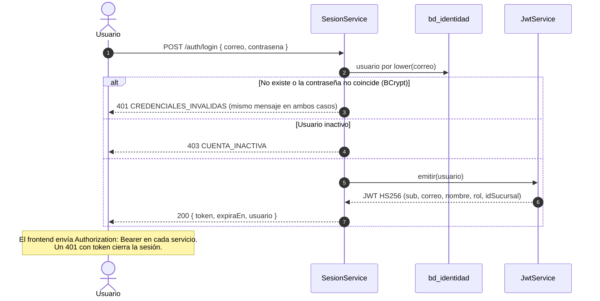
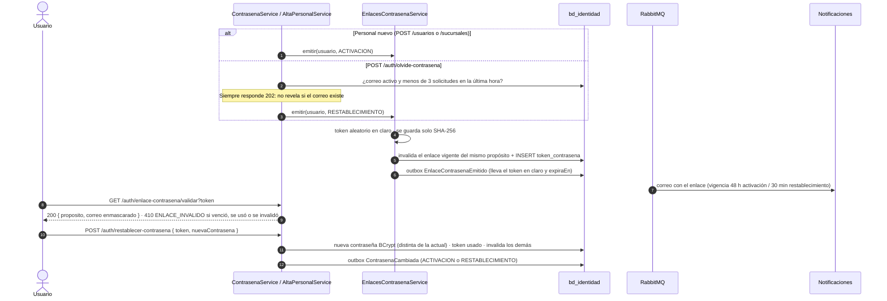
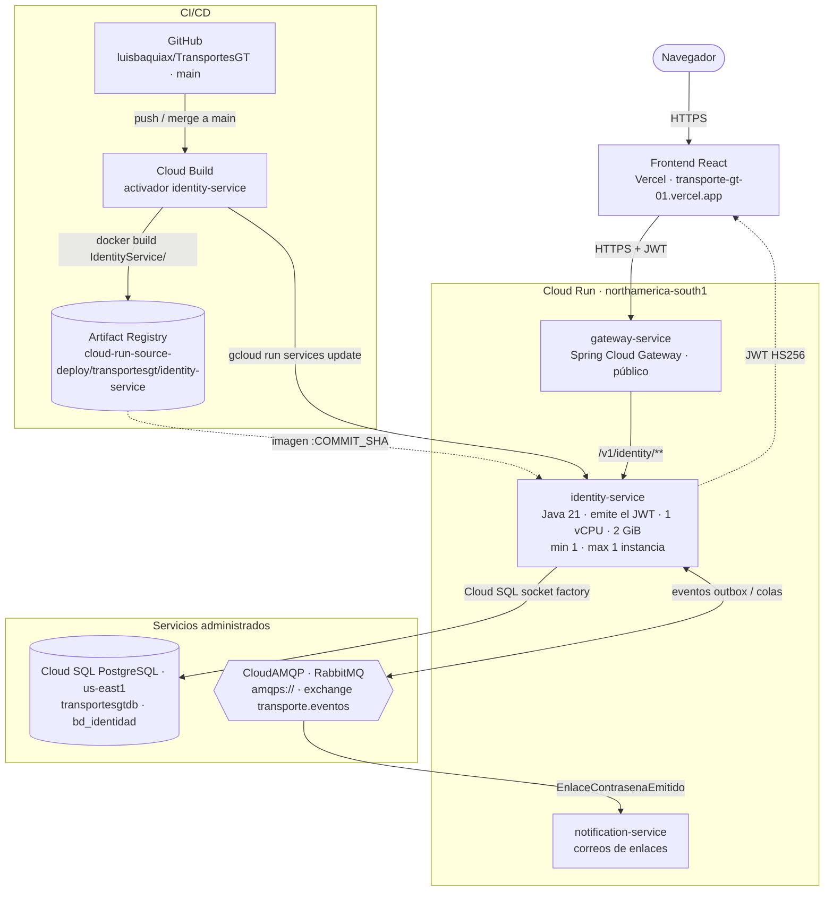

# Manual técnico — servicio-identidad (Identidad y Administración)

Microservicio `IdentityService` de TransportesGT. Hace de servidor de autenticación del sistema y gestiona:
- usuarios y roles;
- sucursales;
- el inicio de sesión y la emisión del JWT que validan todos los demás servicios;
- el ciclo de las contraseñas: activación de cuentas nuevas, cambio, "olvidé mi contraseña" y restablecimiento.

Fuentes de verdad: `modelo-datos-postgresql-v4.md` (tablas de Identidad), `catalogo-eventos-es-v4.md` (eventos de
Identidad) y `plan-de-trabajo.md` (endpoints y reglas de los administradores).

| | |
|---|---|
| Stack | Java 21 · Spring Boot 4.1.1 · Spring Data JPA (Hibernate) · Flyway · Spring AMQP · Spring Security (login con BCrypt y resource server JWT) · MapStruct · springdoc |
| Librería de eventos | `com.github.luisbaquiax:EventosComunesTrasnportesGt:v2.1.1` |
| Puerto / ruta base | `8081` / `/v1/identity` |
| Base de datos | PostgreSQL `bd_identidad` (usuario `svc_identidad`) |
| Broker | RabbitMQ, exchange topic `transporte.eventos` (solo publica) |

Migraciones Flyway:

| Migración | Contenido |
|---|---|
| `V1__esquema_inicial.sql` | Tablas, índices y triggers |
| `V2__datos_iniciales.sql` | Administrador de sistema y 3 sucursales con su administrador, cajero y chofer; dos clientes |

### Usuarios de prueba

Los mismos que documenta el `README` del servicio:

| Rol | Correo | Contraseña |
|---|---|---|
| ADMIN_SISTEMA | `admin@transportes.gt` | `Admin1234` |
| ADMIN_SUCURSAL | `admin.xela@transportes.gt`, `admin.capital@transportes.gt`, `admin.huehue@transportes.gt` | `Admin1234` |
| CAJERO | `cajero.xela@transportes.gt`, `cajero.capital@transportes.gt`, `cajero.huehue@transportes.gt` | `Cajero1234` |
| CHOFER | `chofer101@transportes.gt` a `chofer109@transportes.gt` (uno por chofer de Flota) | `Chofer1234` |
| CLIENTE | `cliente@transportes.gt`, `cliente2@transportes.gt` | `Cliente1234` |

Los `INSERT` de V2 no generan eventos: cada servicio trae en su propia V2 las proyecciones de estos usuarios y
sucursales, con los mismos IDs y versión 0 (`datos-semilla.md`). `POST /admin/republicar-eventos` queda para recuperar
una proyección.

---

## 1. Diagrama de tablas

| Restricción | Garantiza |
|---|---|
| `uq_usuario_correo` sobre `lower(correo)` | Un correo por usuario, sin importar mayúsculas |
| `ck_usuario_sucursal` | El personal de sucursal tiene sucursal; SIS y CLIENTE no |
| `trg_usuario_sin_delete`, `trg_sucursal_sin_delete` | Usuarios y sucursales no se eliminan: solo se desactivan |
| `trg_proteger_ultimo_admin` (bloqueo `pg_advisory_xact_lock(1001)`) | Siempre queda al menos un ADMIN_SISTEMA activo, incluso con desactivaciones simultáneas |
| `trg_proteger_ultimo_admin_sucursal` (bloqueo por sucursal) | Cada sucursal conserva al menos un ADMIN_SUCURSAL activo (al desactivarlo, cambiarle el rol o moverlo) |
| `trg_admin_sucursal_creador` | Solo un ADMIN_SISTEMA activo crea administradores de sucursal |
| `uq_token_activo (id_usuario, proposito)` parcial | Un solo enlace vigente por usuario y propósito |
| `ck_token_vigencia`, `ck_token_estado` | El token vence después de crearse y no puede estar usado e invalidado a la vez |

---

## 2. Diagrama de componentes

| Capa | Paquete | Responsabilidad |
|---|---|---|
| Web | `controllers` | Contrato HTTP, `@Valid`, `@PreAuthorize` por operación, paginación de Spring. Solo dependen de interfaces |
| Seguridad | `config.security` | `SecurityConfig` (rutas públicas de `/auth`, reglas por rol), `JwtService`, `JwtConfig` (HS256), `CustomUserDetailsService`, `ConvertidorUsuarioAutenticado` (claims → `UsuarioAutenticado`) y respuestas 401/403 en JSON |
| Negocio | `services.<tema>` con su `impl` | Una interfaz por caso de uso. **sesion**: login y perfil. **registro**: autorregistro de clientes. **contrasena**: cambio, olvido, validación y restablecimiento (`ValidadorContrasena`) y los enlaces de un solo uso (`EnlacesContrasenaService`). **usuario**: alta de personal (`ValidadorUsuario`) y gestión (`ReglasAdministradores`: último ADMIN_SISTEMA y último ADMIN_SUCURSAL). **sucursal**: alta con su primer administrador, edición y estado (`ValidadorSucursal`). **consulta**: listados y detalle. **admin**: republicar eventos |
| Reglas compartidas | `services.autorizacion`, `services.comun` | `AutorizacionUsuarios` (qué rol crea a quién, quién gestiona y quién ve a quién, sucursal visible en el listado) y `BuscadorIdentidad` (404 de usuario o sucursal) |
| Job | `jobs` | `LimpiezaTokensJob` (cron `identidad.jobs.limpieza-tokens-cron`) delega en `EnlacesContrasenaService.limpiarVencidos`: borra los tokens que vencieron hace más de 7 días (`identidad.retencion-tokens`) |
| Utilidades | `utils` | `NormalizadorCorreo`, `ResolvedorIpCliente` (auditoría) y `GeneradorTokenSeguro`, todos `@Component` |
| Eventos | `eventos` | `EventosIdentidad` arma los payloads y los registra en el outbox |
| Datos | `models`, `repositories` | Entidades (`ddl-auto=validate`) y `UsuarioSpecs`/`SucursalSpecs` (`@Component`) |
| Errores | `exception` | Jerarquía `IdentityServiceException`, `GlobalIdentityServiceExceptionHandler`, `FabricaRespuestaError` y `TraductorErroresBd` (traduce únicos, checks y triggers de PostgreSQL) |

No hay métodos estáticos en las clases del servicio: los helpers son `@Component` inyectables.

### 2.1 Endpoints y permisos

| Método | Ruta | Quién | Evento |
|---|---|---|---|
| POST | `/auth/login` | Público | — (devuelve el JWT y el usuario) |
| POST | `/auth/registro` | Público | `UsuarioCreado` (rol CLIENTE) |
| GET | `/auth/yo` | Autenticado | — |
| POST | `/auth/cambiar-contrasena` | Autenticado | `ContrasenaCambiada` (CAMBIO) |
| POST | `/auth/olvide-contrasena` | Público, siempre 202, máx. 3 por hora | `EnlaceContrasenaEmitido` (RESTABLECIMIENTO) |
| GET | `/auth/enlace-contrasena/validar?token=` | Público | — (200 con el correo enmascarado, o 410 `ENLACE_INVALIDO`) |
| POST | `/auth/restablecer-contrasena` | Público | `ContrasenaCambiada` |
| POST | `/sucursales` | SIS | `SucursalCreada` + `UsuarioCreado` del primer administrador + su enlace de activación |
| GET | `/sucursales`, `/sucursales/{id}` | Autenticado | — |
| PUT / PATCH | `/sucursales/{id}`, `/{id}/activar`, `/{id}/desactivar` | SIS | `SucursalActualizada` |
| GET | `/sucursales/{id}/administradores` | SIS | — |
| POST | `/usuarios` | SIS (crea ADMIN_SISTEMA y ADMIN_SUCURSAL), SUC (crea CAJERO y CHOFER de su sucursal) | `UsuarioCreado` + `EnlaceContrasenaEmitido` (ACTIVACION) |
| GET | `/usuarios`, `/usuarios/{id}` | SIS, SUC (su sucursal); cada usuario el suyo | — |
| PUT | `/usuarios/{id}`, `/usuarios/yo` | Administradores / el propio usuario | `UsuarioActualizado` |
| PATCH | `/usuarios/{id}/activar`, `/desactivar` | SIS, SUC | `UsuarioActualizado` |
| POST | `/usuarios/{id}/reenviar-activacion` | SIS, SUC | `EnlaceContrasenaEmitido` |
| POST | `/admin/republicar-eventos` | SIS | Republica `SucursalCreada` y `UsuarioCreado` de todo lo existente |

**JWT:**
- HS256, emisor `servicio-identidad`, vigencia `JWT_EXPIRATION` (1 h por omisión).
- Claims: `sub` = id del usuario, `correo`, `nombre`, `rol` (sin prefijo) e `idSucursal` (solo el personal de
  sucursal).
- Los demás servicios lo validan con el mismo secreto y emisor y mapean el rol a `ROLE_<rol>`.

---

## 3. Inicio de sesión

---

## 4. Enlaces de contraseña (activación y restablecimiento)

- **Activación:** el personal creado por un administrador no recibe contraseña. La define con el enlace de
  activación, que se puede reenviar con `POST /usuarios/{id}/reenviar-activacion`.
- **Registro de clientes:** el autorregistro (`/auth/registro`) crea un CLIENTE con contraseña. Clientes y Cartera
  crea su perfil al consumir `UsuarioCreado`.
- **Desactivación:** `UsuarioActualizado` con `activo = false` bloquea la cartera en Clientes y Cartera. Los
  triggers impiden quedarse sin administradores.

| Evento publicado | Llave | Consumidores |
|---|---|---|
| `UsuarioCreado` / `UsuarioActualizado` | `identidad.usuario.creado` / `.actualizado` | Clientes y Cartera, Notificaciones |
| `SucursalCreada` / `SucursalActualizada` | `identidad.sucursal.creada` / `.actualizada` | Flota, Viajes, Alquileres, Costos, Reportes |
| `EnlaceContrasenaEmitido` | `identidad.usuario.enlace-contrasena-emitido` | Notificaciones |
| `ContrasenaCambiada` | `identidad.usuario.contrasena-cambiada` | Notificaciones |

Identidad no consume eventos.

---

## 5. Diagrama de despliegue

Producción en Google Cloud (proyecto `unimarketcunoc`). En local, `infra/docker-compose.yml` levanta lo mismo con
PostgreSQL y RabbitMQ en contenedores.

| Elemento | Detalle |
|---|---|
| Imagen | `Dockerfile` en dos etapas: `maven:3.9-eclipse-temurin-21` compila (`./mvnw clean package`) y `bellsoft/liberica-openjdk-alpine:21` ejecuta `app.jar` |
| CI/CD | Cada merge a `main` dispara el activador de Cloud Build: `docker build IdentityService -f IdentityService/Dockerfile`, push a Artifact Registry con la etiqueta del commit y `gcloud run services update identity-service` |
| Base de datos | Cloud SQL `unimarketcunoc:us-east1:transportesgtdb`, base `bd_identidad`, por la *socket factory* (`jdbc:postgresql:///bd_identidad?cloudSqlInstance=…&socketFactory=…`) |
| Configuración | Variables de entorno: `SPRING_PROFILES_DEFAULT=prod`, `SPRING_DATASOURCE_*`, `RABBITMQ_URL`, `JWT_SECRET` (el mismo de todos los servicios), `JWT_EXPIRATION`, `IDENTIDAD_VIGENCIA_ACTIVACION`, `IDENTIDAD_VIGENCIA_RESTABLECIMIENTO`, `CORS_ALLOWED_ORIGINS`, `SERVER_PORT=8080`, `SWAGGER_HABILITADO`, `DB_POOL_MAX` |
| Esquema | Flyway aplica las migraciones al arrancar; Hibernate solo valida. En la nube no se modifican migraciones ya aplicadas: los cambios van en una versión nueva |
| Instancias | Exactamente 1 (`min` y `max`). Varias serían seguras: el outbox y `evento_procesado` hacen idempotente el consumo |
| CPU | Hoy con CPU solo durante peticiones (valor por defecto). Para que los consumidores procesen eventos sin tráfico HTTP conviene `--no-cpu-throttling` |
| Publica | `SucursalCreada/Actualizada`, `UsuarioCreado/Actualizado`, `EnlaceContrasenaEmitido`, `ContrasenaCambiada`. No consume eventos |
| Acceso | Público (`ingress=all`, sin IAM de invocación); los datos los protege el JWT. Pendiente: dejar público solo el gateway |
| Cuenta de servicio | La de Compute por defecto (`…-compute@developer.gserviceaccount.com`), compartida con los demás servicios |
| Salud | `/v1/identity/actuator/health` (`liveness` y `readiness`) |
