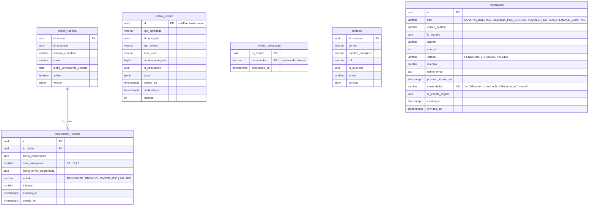
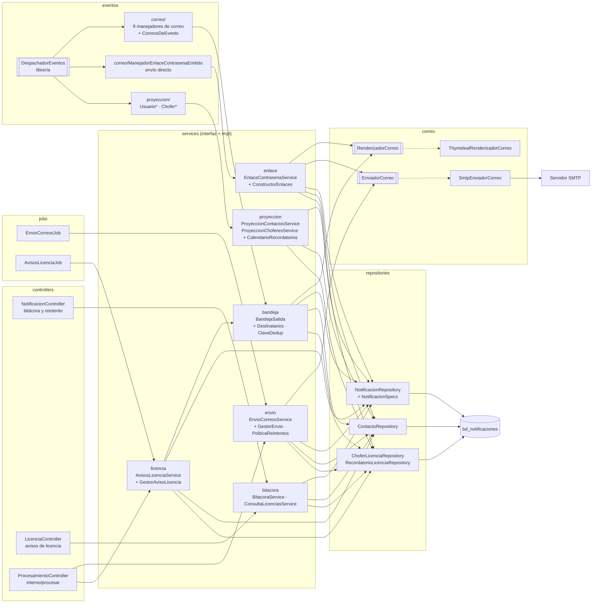
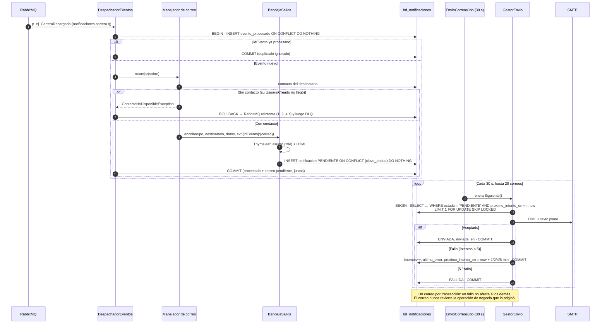
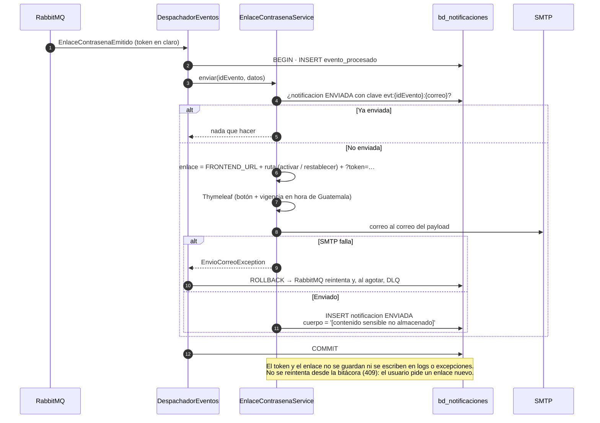
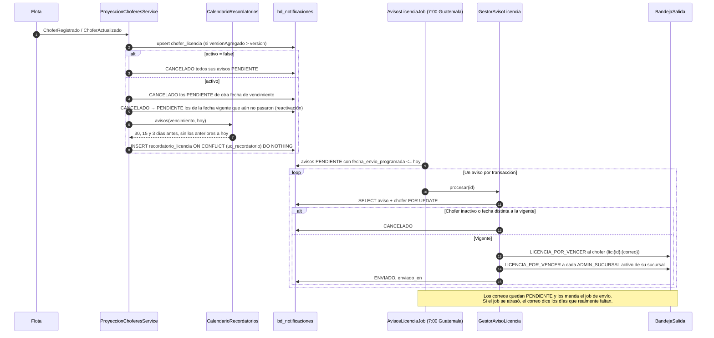
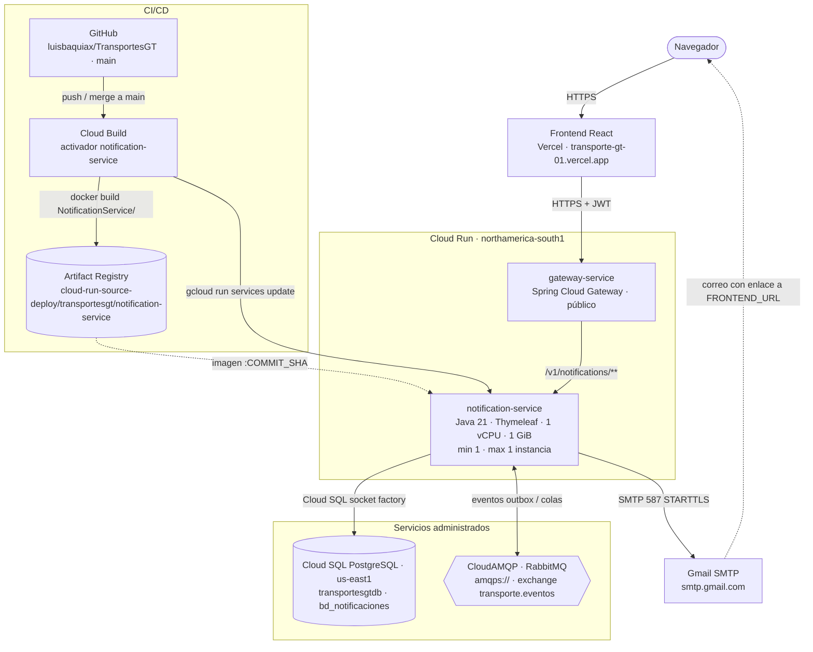

# Manual técnico — servicio-notificaciones

Microservicio `NotificationService` de TransportesGT. Envía todos los correos del sistema a partir de los eventos de
los demás servicios: confirmaciones de compra, avisos de cartera y de alquileres, enlaces y avisos de contraseña, y
avisos de vencimiento de licencia. **Solo consume eventos**: no publica eventos ni llama a otros servicios. Fuentes de
verdad: `modelo-datos-postgresql-v4.md` §8 (tablas y reglas) y `catalogo-eventos-es-v4.md` §2.1, §2.2, §2.4–§2.6, §3 y
§4.5.

| | |
|---|---|
| Stack | Java 21 · Spring Boot 4.1.1 · Spring Data JPA (Hibernate) · Flyway · Spring AMQP · Spring Security (resource server JWT) · Spring Mail · Thymeleaf · springdoc |
| Librería de eventos | `com.github.luisbaquiax:EventosComunesTrasnportesGt:v2.1.1` (sobre, payloads, consumidor idempotente, topología) |
| Puerto / ruta base | `8088` / `/v1/notifications` |
| Base de datos | PostgreSQL `bd_notificaciones` |
| Broker | RabbitMQ, exchange topic `transporte.eventos`, DLX `transporte.eventos.dlx` |
| Correo | SMTP con STARTTLS (587). En local, Mailpit; en las pruebas, GreenMail |

Tablas: `contacto` y `chofer_licencia` (proyecciones, solo las modifican los consumidores), `recordatorio_licencia`,
`notificacion` (bitácora y bandeja de salida), `evento_procesado` y `outbox_evento`. Esta última queda vacía, pero
existe porque el publicador del outbox de la librería se registra siempre y la consulta cada segundo.

---

## 1. Diagrama de tablas

Generado de `V1__esquema_inicial.sql`. `contacto` y `chofer_licencia` son proyecciones de Identidad y Flota; `notificacion` es la bandeja de salida y la bitácora de cada correo.

## 2. Diagrama de componentes

| Capa | Paquete | Responsabilidad |
|---|---|---|
| Web | `controllers` | Bitácora, reintento, avisos de licencia y ejecución manual de los jobs |
| Seguridad | `config.security` | Validar JWT; reglas: `GET /notificaciones/licencias` → SIS y SUC, el resto → SIS |
| Eventos | `eventos.proyeccion`, `eventos.correo` | Un manejador por evento (un evento nuevo = un manejador nuevo, sin tocar los demás). Validan, eligen destinatarios y delegan |
| Negocio | `services.<tema>` (+ `impl`) | `proyeccion` (copias locales y programación de avisos), `bandeja` (encolar `PENDIENTE`), `enlace` (envío directo), `envio` (job de envío), `licencia` (job de avisos), `bitacora` (consultas y reintento) |
| Correo | `correo` | Puertos `RenderizadorCorreo` y `EnviadorCorreo` con sus adaptadores Thymeleaf y SMTP: los servicios no dependen de JavaMail ni de Thymeleaf |
| Datos | `models`, `repositories` | Entidades (`ddl-auto=validate`), *upserts* por versión, `ON CONFLICT DO NOTHING`, `FOR UPDATE SKIP LOCKED` |
| Errores | `exception` | Jerarquía `NotificationServiceException` y `RespuestaError` uniforme |

---

## 3. Flujo del correo: consumidor → PENDIENTE → job → SMTP

- **Idempotencia doble:** `evento_procesado` evita reprocesar un evento ya confirmado, y `clave_dedup` es el
  respaldo dentro de la base: el mismo `idEvento` nunca produce dos correos al mismo destinatario. Un evento con otro
  `idEvento` es otro hecho y sí genera su propio correo.
- **Varias instancias:** `SKIP LOCKED` hace que cada instancia tome filas distintas; la fila queda bloqueada mientras
  se envía.
- **Reintento manual:** `POST /notificaciones/{id}/reintentar` deja un `FALLIDA` en `PENDIENTE` con 0 intentos.

---

## 4. Envío directo de EnlaceContrasenaEmitido

- No pasa por la bandeja porque el cuerpo guardado tendría el secreto, y el job lo necesitaría para reenviarlo.
- Si el SMTP acepta el correo pero el `COMMIT` falla, el reintento lo envía otra vez (entrega *al menos una vez*): es
  preferible a perder el enlace.

---

## 5. Avisos de vencimiento de licencia

"Hoy" se calcula con el `Clock` inyectado en `America/Guatemala`. El aviso cuya fecha es hoy sí se programa: lo envía
el job de hoy (o la siguiente corrida si ya pasó la de las 7:00).

---

## 6. Diagrama de despliegue

Producción en Google Cloud (proyecto `unimarketcunoc`). En local, `infra/docker-compose.yml` levanta lo mismo con
PostgreSQL y RabbitMQ en contenedores.

| Elemento | Detalle |
|---|---|
| Imagen | `Dockerfile` en dos etapas: `maven:3.9-eclipse-temurin-21` compila (`./mvnw clean package`) y `bellsoft/liberica-openjdk-alpine:21` ejecuta `app.jar` |
| CI/CD | Cada merge a `main` dispara el activador de Cloud Build: `docker build NotificationService -f NotificationService/Dockerfile`, push a Artifact Registry con la etiqueta del commit y `gcloud run services update notification-service` |
| Base de datos | Cloud SQL `unimarketcunoc:us-east1:transportesgtdb`, base `bd_notificaciones`, por la *socket factory* (`jdbc:postgresql:///bd_notificaciones?cloudSqlInstance=…&socketFactory=…`) |
| Configuración | Variables de entorno: `SPRING_PROFILES_DEFAULT=prod`, `SPRING_DATASOURCE_*`, `RABBITMQ_URL`, `JWT_SECRET` (el mismo de todos los servicios), `MAIL_HOST`, `MAIL_PORT`, `MAIL_USERNAME`, `MAIL_PASSWORD`, `MAIL_SMTP_AUTH`, `MAIL_REMITENTE`, `FRONTEND_URL`, `JWT_ISSUER`, `SERVER_PORT=8080`, `SWAGGER_HABILITADO`, `DB_POOL_MAX` |
| Esquema | Flyway aplica las migraciones al arrancar; Hibernate solo valida. En la nube no se modifican migraciones ya aplicadas: los cambios van en una versión nueva |
| Instancias | Exactamente 1 (`min` y `max`). Varias serían seguras: el outbox y `evento_procesado` hacen idempotente el consumo |
| CPU | Hoy con CPU solo durante peticiones (valor por defecto). Sus jobs (`@Scheduled`) y los consumidores de RabbitMQ necesitan CPU sin tráfico HTTP: conviene `--no-cpu-throttling` |
| Correo | Gmail SMTP (`smtp.gmail.com:587`, STARTTLS) con contraseña de aplicación. Los enlaces de activación y restablecimiento apuntan a `FRONTEND_URL` (Vercel) |
| Jobs | El envío de correos pendientes y los avisos de licencia corren con `@Scheduled`; además `POST /interno/procesar` los dispara a demanda |
| Acceso | Público (`ingress=all`, sin IAM de invocación); los datos los protege el JWT. Pendiente: dejar público solo el gateway |
| Cuenta de servicio | La de Compute por defecto (`…-compute@developer.gserviceaccount.com`), compartida con los demás servicios |
| Salud | `/v1/notifications/actuator/health` (`liveness` y `readiness`) |
