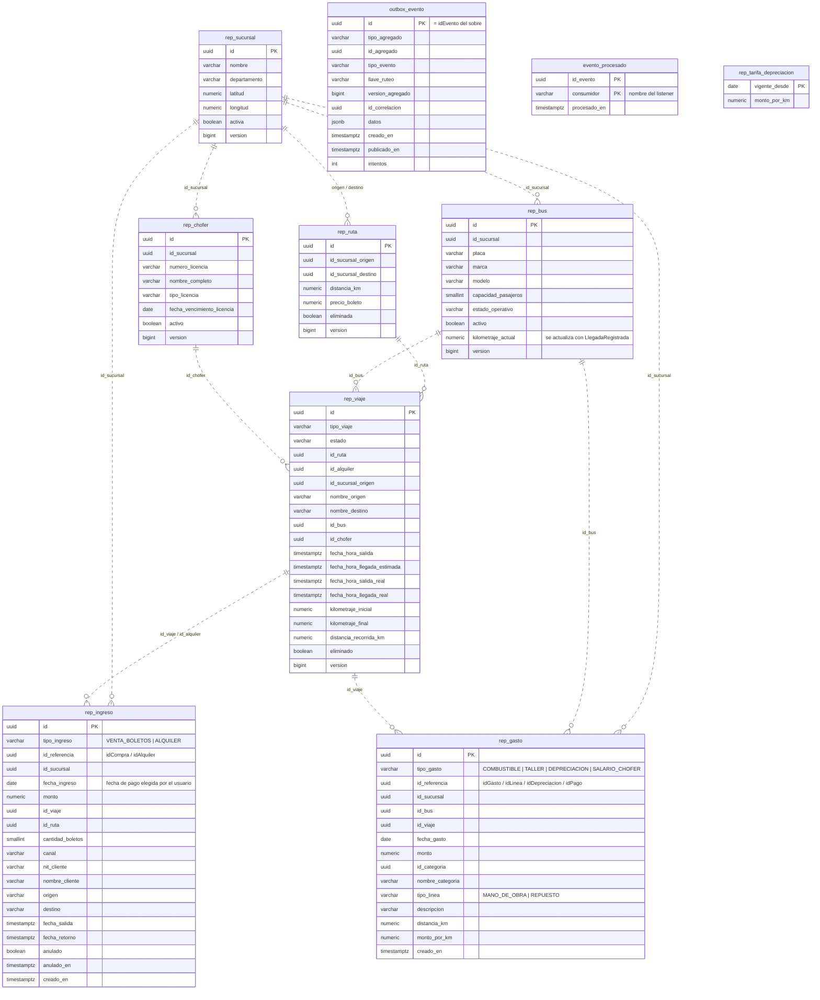
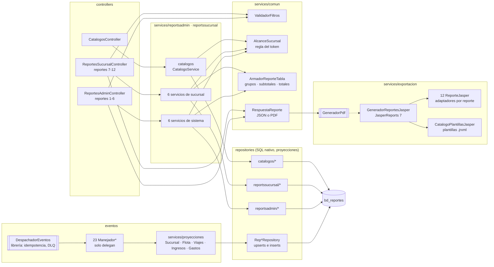
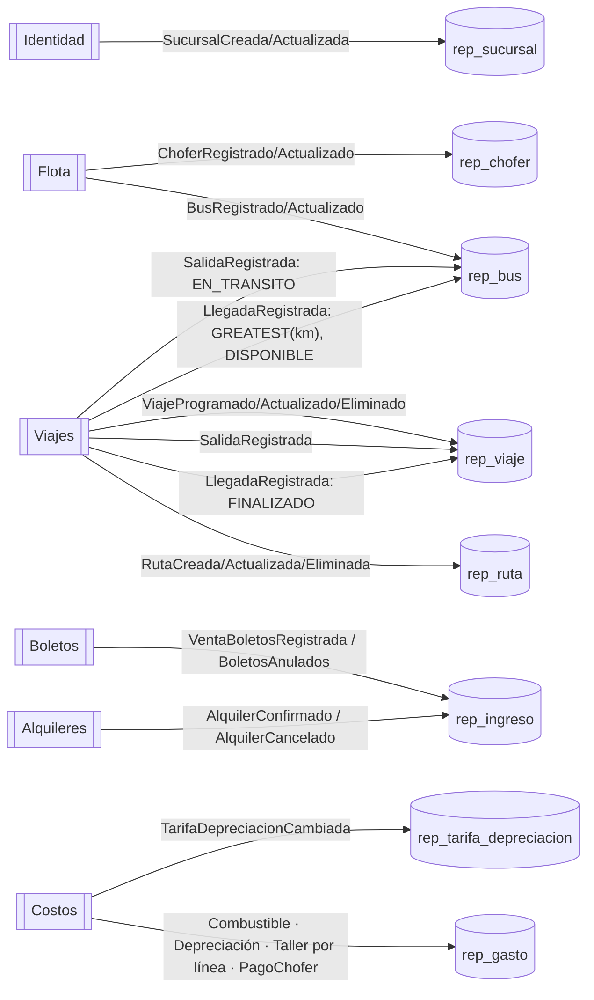
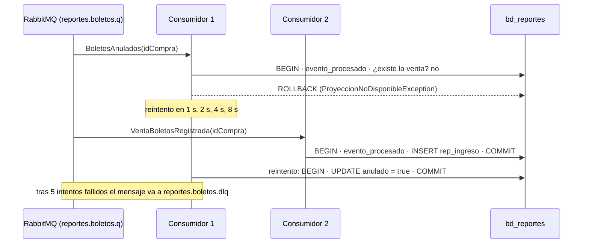
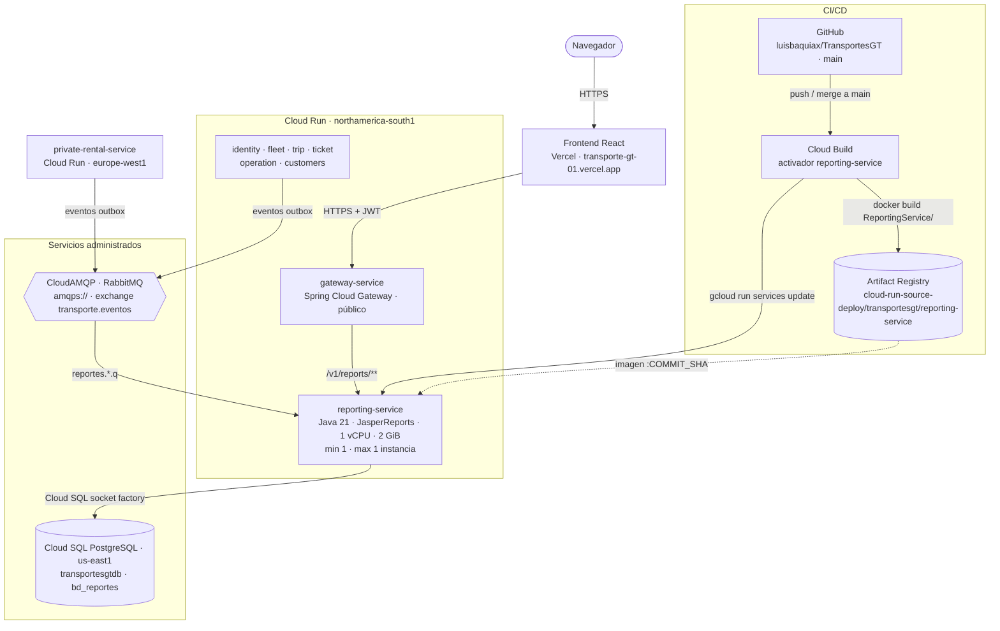

# Manual técnico — servicio-reportes (Reportes)

Microservicio `ReportingService` de TransportesGT. Mantiene proyecciones de lectura alimentadas solo por eventos y
genera los 12 reportes del enunciado (administrador del sistema y administrador de sucursal). No publica eventos ni
llama a otros servicios. Fuentes de verdad: `modelo-datos-postgresql-v4.md` §9, `catalogo-eventos-es-v4.md` §1–§3
y `plan-de-trabajo.md` §3.9.

| | |
|---|---|
| Stack | Java 21 · Spring Boot 4.1.1 · Spring Data JPA (Hibernate 7, SQL nativo para los reportes) · Flyway · Spring AMQP · Spring Security (resource server JWT) · springdoc |
| Librería de eventos | `com.github.luisbaquiax:EventosComunesTrasnportesGt:v2.1.1` (sobre, payloads, consumidor idempotente, topología) |
| Puerto / ruta base | `8089` / `/v1/reports` |
| Base de datos | PostgreSQL `bd_reportes` |
| Broker | RabbitMQ, exchange topic `transporte.eventos`, DLX `transporte.eventos.dlx` |
| PDF | JasperReports 7: `formato=pdf` genera el reporte con su plantilla `.jrxml` (`GeneradorReportesJasper`) |

---

## 1. Diagrama de tablas

Sin `FOREIGN KEY`: los eventos llegan desordenados y las uniones se hacen por `id` al consultar. Las líneas
punteadas son relaciones lógicas.

La vista `v_resumen_diario_sucursal` suma ingresos no anulados y gastos por sucursal y día (base del reporte de
ganancias). `outbox_evento` existe solo porque el publicador de la librería arranca siempre.

## 2. Diagrama de componentes

- Una interfaz por caso de uso y su implementación en `impl/`; los controladores dependen solo de interfaces.
- Sin métodos estáticos propios: los helpers (`AlcanceSucursal`, `ArmadorReporteTabla`, `TextosReporte`,
  `FilasTaller`, `Dinero`, `Fechas`) son `@Component`.
- Cada reporte arma un `ReporteTabla` (título, filtros, `generadoEn`, grupos con subtotales y totales) que sirve
  tanto para JSON como para el futuro PDF.

## 3. Cómo cada evento alimenta cada tabla

| Evento | Tipo | Efecto | Si falta lo que necesita |
|---|---|---|---|
| Sucursal / Bus / Chofer / Ruta / Viaje (Creado, Actualizado) | Instantánea | Upsert si `versionAgregado` es mayor. `BusActualizado` no toca el kilometraje. `rep_viaje.estado` nunca baja de `FINALIZADO` | — (crea la fila) |
| `RutaEliminada`, `ViajeEliminado` | Hecho | `eliminada` / `eliminado = true` | Transitorio (reintento) |
| `SalidaRegistrada` | Hecho | Salida real e inicial; bus `EN_TRANSITO` (no si la llegada ya se aplicó) | Transitorio |
| `LlegadaRegistrada` | Hecho | Llegada, km final, distancia, `FINALIZADO`; bus `GREATEST(km)` y `DISPONIBLE` | Transitorio (sin bus proyectado solo avisa) |
| `VentaBoletosRegistrada` | Hecho | Ingreso `VENTA_BOLETOS` (`cantidad_boletos = asientos.size()`) | — |
| `BoletosAnulados`, `AlquilerCancelado` | Hecho | `anulado = true` sobre la fecha de pago original | Transitorio: no crea filas incompletas |
| `AlquilerConfirmado` | Hecho | Ingreso `ALQUILER` (canal `MOSTRADOR` si no hay `idPago`) | — |
| Gastos de Costos | Hecho | Una fila por gasto; taller una por línea; el salario toma el bus del viaje | — |
| `TarifaDepreciacionCambiada` | Hecho | Upsert por `vigente_desde` | — |

Un evento sin su id o sin datos es **no recuperable** (DLQ inmediata). Un JSON inválido lo manda a la DLQ la
librería.

### Consumo y reintentos

## 4. Diagrama de despliegue

Producción en Google Cloud (proyecto `unimarketcunoc`). En local, `infra/docker-compose.yml` levanta lo mismo con
PostgreSQL y RabbitMQ en contenedores y el servicio en el puerto 8089.

| Elemento | Detalle |
|---|---|
| Imagen | `Dockerfile` en dos etapas: `maven:3.9-eclipse-temurin-21` compila (`./mvnw clean package`) y `eclipse-temurin:21-jre` ejecuta `app.jar` con `-Djava.awt.headless=true` (JasperReports genera los PDF sin pantalla) |
| CI/CD | Cada merge a `main` dispara el activador de Cloud Build: `docker build ReportingService -f ReportingService/Dockerfile`, push a Artifact Registry con la etiqueta del commit y `gcloud run services update reporting-service` |
| Base de datos | Cloud SQL `unimarketcunoc:us-east1:transportesgtdb`, base `bd_reportes`, por la *socket factory* (`jdbc:postgresql:///bd_reportes?cloudSqlInstance=…&socketFactory=…`). Pool de 5 conexiones (`DB_POOL_MAX`) |
| Configuración | Variables de entorno: `SPRING_PROFILES_DEFAULT=prod`, `SPRING_DATASOURCE_*`, `RABBITMQ_URL`, `JWT_SECRET` (el mismo de todos los servicios), `JWT_ISSUER`, `SERVER_PORT=8080`, `SWAGGER_HABILITADO`, `DB_POOL_MAX` |
| Esquema | Flyway aplica `V1` y `V2` al arrancar; Hibernate solo valida. En la nube no se modifican migraciones ya aplicadas: los cambios van en una `V3` nueva |
| Instancias | Exactamente 1 (`min` y `max`) porque consume colas. Varias serían seguras por la idempotencia de `evento_procesado` |
| CPU | Hoy con CPU solo durante peticiones (valor por defecto). Para que los consumidores procesen eventos sin tráfico HTTP conviene `--no-cpu-throttling` |
| Acceso | Público (`ingress=all`, sin IAM de invocación); los datos los protege el JWT. Pendiente: dejar público solo el gateway |
| Cuenta de servicio | La de Compute por defecto (`…-compute@developer.gserviceaccount.com`), compartida con los demás servicios |
| Orden de arranque | Reportes antes que los productores, para que sus colas existan (ver README, "Reponer eventos"). Si se pierden eventos, la página **Sincronización** los republica |
| Salud | `/v1/reports/actuator/health` (`liveness` y `readiness`); el arranque tarda cerca de 90 s |

## 5. Supuestos y decisiones

- **Filtros por fecha de negocio:** ingresos por `fecha_ingreso` (fecha de pago elegida por el usuario); gastos por
  `fecha_gasto` (fecha de servicio de taller, de cálculo de depreciación, del gasto de combustible o del pago al
  chofer). Nunca por `ocurridoEn` (decisión #9 del catálogo). En buses y choferes, el intervalo limita los viajes
  realizados por fecha de llegada real (hora de Guatemala).
- **Salario del chofer como gasto** (`SALARIO_CHOFER`), incluido en gastos y ganancias (plan §3.9).
- **Anulación retroactiva:** anular una venta o un alquiler marca el ingreso sobre su fecha de pago original, así
  que el reporte de ese periodo cambia.
- **Taller:** el reporte de gastos separa mano de obra (`TALLER`) y repuesto (`REPUESTO`) según `tipo_linea`.
- **Chofer actual de un bus:** el del viaje `EN_TRANSITO`; si no, el del próximo `PROGRAMADO` (desde ahora); si no,
  vacío.
- **Tarifa de depreciación del reporte 11:** la vigente hoy (`vigente_desde <= hoy`, la más reciente); el promedio
  aplicado sale de lo realmente cobrado en cada viaje.
- **"Hoy"** (tarifa vigente, licencias por vencer, próximo viaje) sale del `Clock` en America/Guatemala.
- **Sucursales** en orden alfabético con reglas del español (`Collator`), igual en todos los reportes.
- **Formato de error y correlación:** se mantiene `RespuestaError` y `X-Id-Correlacion` del código existente (el
  plan §2.3 proponía `ProblemDetail`).
