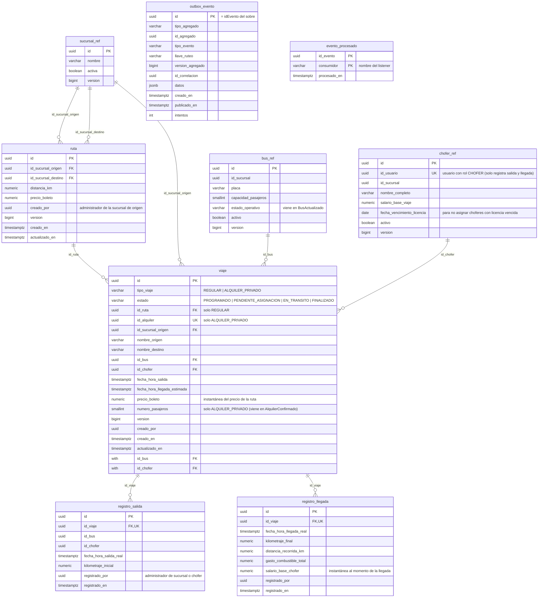
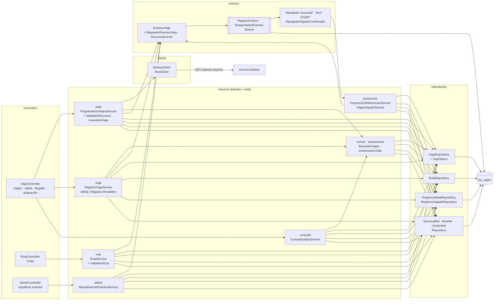
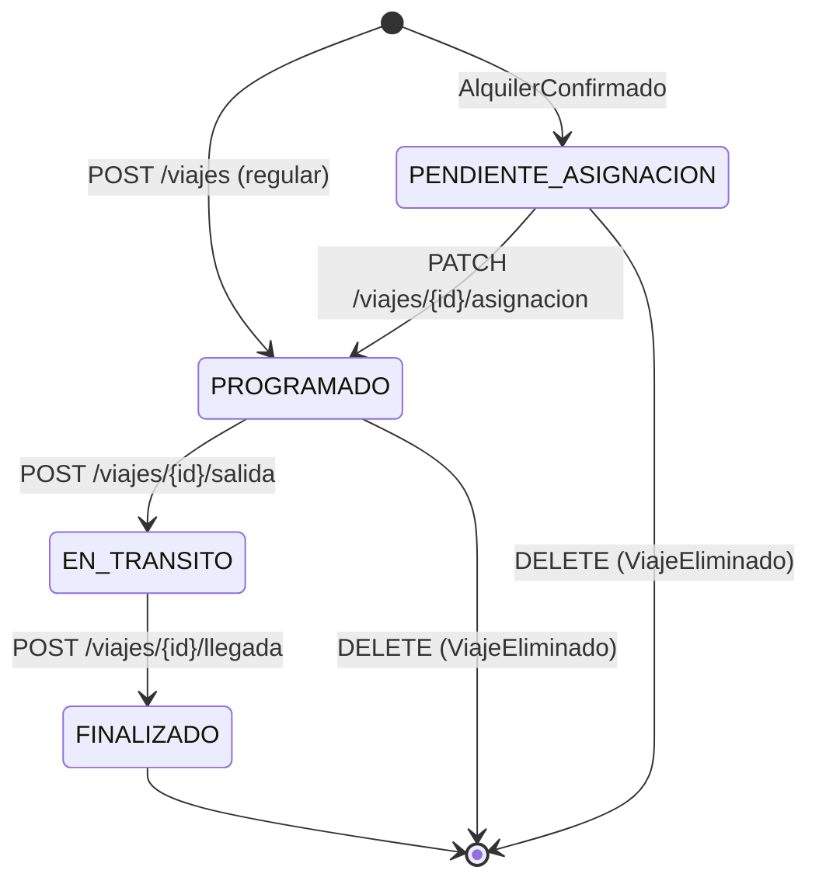
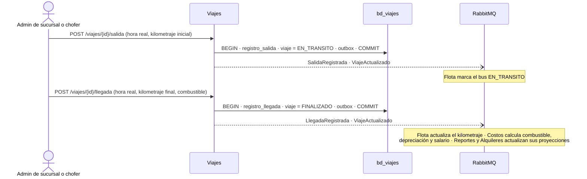
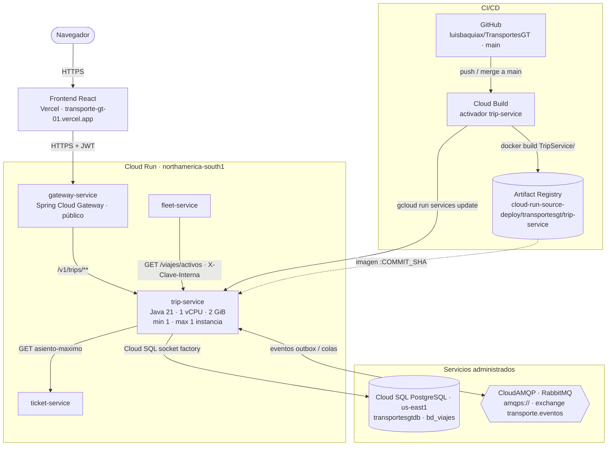

# Manual técnico — servicio-viajes (Viajes)

Microservicio `TripService` de TransportesGT. Es la fuente de verdad de las **rutas** y los **viajes**:
- rutas entre sucursales (las define el administrador de la sucursal de origen);
- viajes regulares programados con bus, chofer y horario;
- viajes de alquiler, que nacen al confirmarse un alquiler y esperan bus y chofer;
- registros **inmutables** de salida y llegada, con el kilometraje y el combustible.

Fuentes de verdad: `modelo-datos-postgresql-v4.md` (tablas de Viajes), `catalogo-eventos-es-v4.md` (eventos de
Viajes) y `plan-de-trabajo.md` (endpoints de rutas y viajes).

| | |
|---|---|
| Stack | Java 21 · Spring Boot 4.1.1 · Spring Data JPA (Hibernate) · Flyway · Spring AMQP · Spring Security (resource server JWT) · RestClient · MapStruct · springdoc |
| Librería de eventos | `com.github.luisbaquiax:EventosComunesTrasnportesGt` (sobre, payloads, outbox, consumidor idempotente) |
| Puerto / ruta base | `8083` / `/v1/trips` |
| Base de datos | PostgreSQL `bd_viajes` |
| Broker | RabbitMQ, exchange topic `transporte.eventos`, DLX `transporte.eventos.dlx` |

---

## 1. Diagrama de tablas

Generado de `V1__esquema_inicial.sql`. `sucursal_ref`, `bus_ref` y `chofer_ref` son proyecciones de Identidad y Flota; `registro_salida` y `registro_llegada` son inmutables (un trigger bloquea UPDATE y DELETE).

## 2. Diagrama de componentes

- Una interfaz por caso de uso y su implementación en `impl/`; los controladores dependen solo de interfaces.
- `ProgramacionViajesService` crea, edita, asigna y elimina viajes; `RegistroViajeService` registra la salida y la
  llegada. Las validaciones de bus y chofer (activos, de la sucursal, licencia vigente, sin traslapes) están en
  `ValidadorRecursos`.
- Los eventos se guardan en el outbox en la misma transacción que el cambio (`EventosViaje`).

## 3. Ciclo de vida de un viaje

- Un viaje `EN_TRANSITO` o `FINALIZADO` no se edita ni se elimina (`VIAJE_NO_ELIMINABLE`).
- Al cambiar el bus de un viaje con boletos, consulta a Boletos `asiento-maximo` y rechaza un bus más pequeño.
- La salida y la llegada las registra el administrador de la sucursal o el chofer **de su propio viaje**
  (`AutorizacionViaje` compara el `idUsuario` del token con el `id_usuario` de `chofer_ref`).

## 4. Salida y llegada

## 5. Diagrama de despliegue

Producción en Google Cloud (proyecto `unimarketcunoc`). En local, `infra/docker-compose.yml` levanta lo mismo con
PostgreSQL y RabbitMQ en contenedores.

| Elemento | Detalle |
|---|---|
| Imagen | `Dockerfile` en dos etapas: `maven:3.9-eclipse-temurin-21` compila (`./mvnw clean package`) y `bellsoft/liberica-openjdk-alpine:21` ejecuta `app.jar` |
| CI/CD | Cada merge a `main` dispara el activador de Cloud Build: `docker build TripService -f TripService/Dockerfile`, push a Artifact Registry con la etiqueta del commit y `gcloud run services update trip-service` |
| Base de datos | Cloud SQL `unimarketcunoc:us-east1:transportesgtdb`, base `bd_viajes`, por la *socket factory* (`jdbc:postgresql:///bd_viajes?cloudSqlInstance=…&socketFactory=…`) |
| Configuración | Variables de entorno: `SPRING_PROFILES_DEFAULT=prod`, `SPRING_DATASOURCE_*`, `RABBITMQ_URL`, `JWT_SECRET` (el mismo de todos los servicios), `BOLETOS_URL`, `CLAVE_INTERNA`, `SERVER_PORT=8080`, `SWAGGER_HABILITADO`, `DB_POOL_MAX` |
| Esquema | Flyway aplica las migraciones al arrancar; Hibernate solo valida. En la nube no se modifican migraciones ya aplicadas: los cambios van en una versión nueva |
| Instancias | Exactamente 1 (`min` y `max`). Varias serían seguras: el outbox y `evento_procesado` hacen idempotente el consumo |
| CPU | Hoy con CPU solo durante peticiones (valor por defecto). Para que los consumidores procesen eventos sin tráfico HTTP conviene `--no-cpu-throttling` |
| Llamadas | Consulta a Boletos `asiento-maximo` antes de cambiar el bus de un viaje; Flota le consulta `/viajes/activos` con `X-Clave-Interna` |
| Acceso | Público (`ingress=all`, sin IAM de invocación); los datos los protege el JWT. Pendiente: dejar público solo el gateway |
| Cuenta de servicio | La de Compute por defecto (`…-compute@developer.gserviceaccount.com`), compartida con los demás servicios |
| Salud | `/v1/trips/actuator/health` (`liveness` y `readiness`) |
