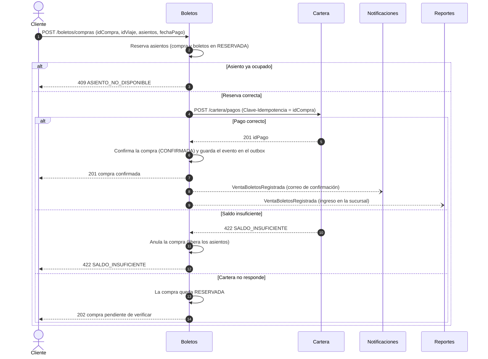
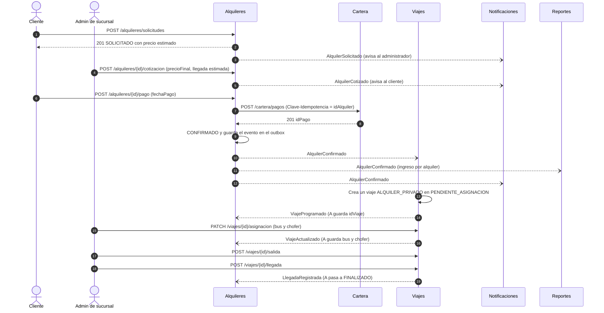
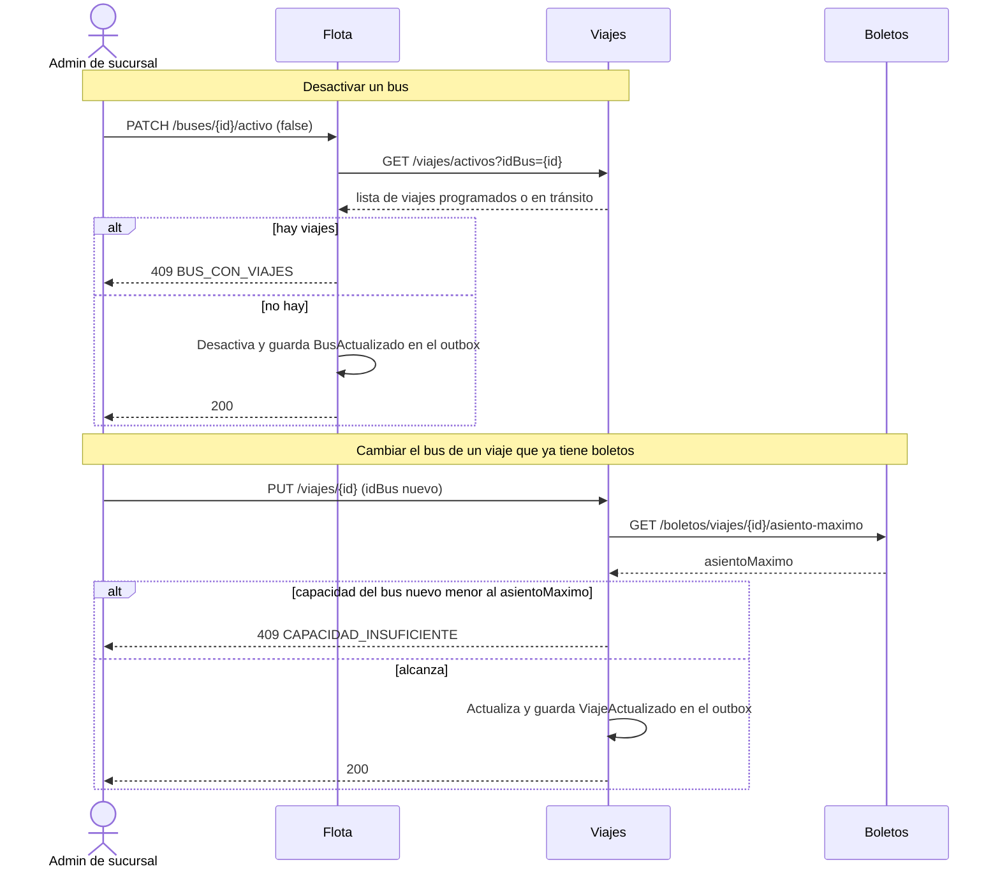
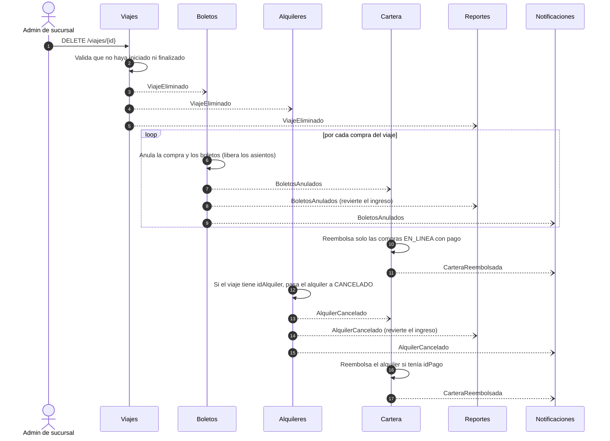
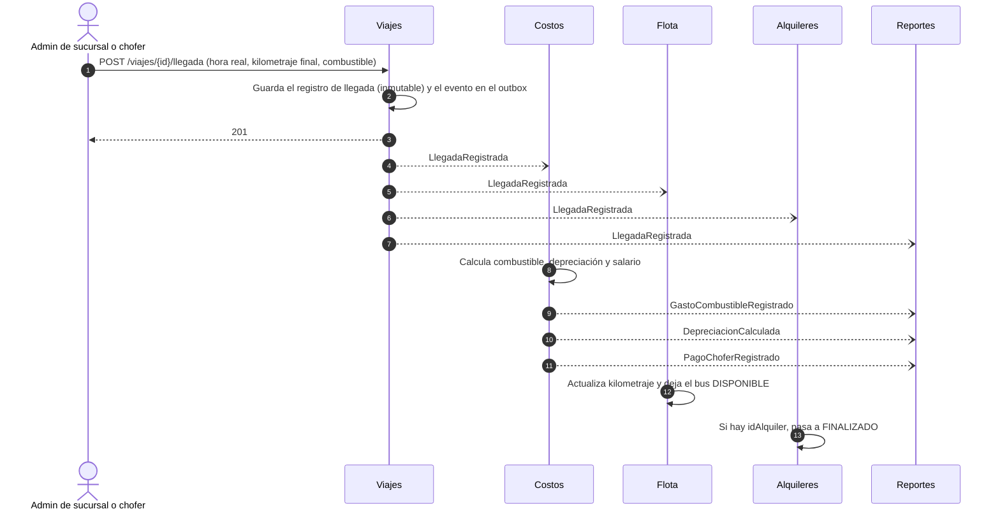

# Plan de trabajo — Plataforma de transporte extraurbano

Documento de coordinación entre las dos personas del equipo. Complementa (no reemplaza) a:

- `catalogo-eventos-es-v4.md` → contrato **asíncrono** (32 eventos).
- `modelo-datos-postgresql-v4.md` → tablas, restricciones y triggers.
- `eventos-comun` (versión **1.1.0**) → librería (sobre, outbox, consumidor idempotente, RabbitMQ, `Nit`).

Este documento fija lo que faltaba: **quién hace qué**, el **contrato REST** (endpoints), el **orden de las llamadas** en los flujos principales y las **convenciones** para que los servicios encajen sin sorpresas. La seguridad (JWT, filtro, CORS) se trabaja aparte; aquí solo se asume su resultado (ver §2.4).

> Propuesta para revisión: todo lo marcado como **[confirmar]** es una decisión que conviene cerrar entre los dos antes de programar.

---

## 1. Reparto

Se reparte por flujo de negocio, para que cada persona pueda probar su flujo completo con pocas dependencias de la otra. La carga se estimó con puntos de 1 a 5.

| | Persona A — acceso y ventas | Pts | Persona B — operación | Pts |
|---|---|---|---|---|
| 1 | **Identidad + API Gateway** (usuarios, sucursales, contraseñas) | 5 | **Flota** (buses, choferes) | 2 |
| 2 | **Clientes y Cartera** (perfil, cartera, pagos, reembolsos) | 3 | **Viajes** (rutas, viajes, salida y llegada) | 5 |
| 3 | **Boletos** (compra en línea, mostrador, asientos) | 4 | **Alquileres** (solicitud, cotización, pago) | 3 |
| 4 | **Notificaciones** (correos, avisos de licencia) | 3 | **Costos** (taller, categorías, depreciación, combustible, salario) | 4 |
| 5 | **Reportes**: base y motor de PDF + 5 reportes | ~3 | **Reportes**: 7 reportes | ~3 |
| | **Total** | **~18** | **Total** | **~17** |

**Reparto de los 12 reportes** (según de dónde salen los datos):

| Persona A | Persona B |
|---|---|
| Ingresos · Ganancias · Rutas más demandadas · Ingresos por boletos · Ingresos por alquiler | Gastos · Gastos de taller por categoría · Mapa de rutas · Listado de buses · Listado de choferes · Depreciación por bus · Gastos de taller por bus |

A además monta la base de Reportes (consumidores de eventos, estructura del servicio y el motor de PDF); B la reutiliza.

### 1.1 Dónde se cruzan los dos lados

Las llamadas síncronas que cruzan de B hacia A son tres (el pago, la consulta del pago y `asiento-maximo`); ninguna va de A hacia B. Todo lo demás cruza por eventos, ya definidos en el catálogo.

| Llamada | De → A | Quién la implementa | Quién la consume |
|---|---|---|---|
| `POST /cartera/pagos` (alquiler) | Alquileres (B) → Cartera (A) | A | B |
| `GET /cartera/pagos?tipoReferencia=&idReferencia=` | Alquileres (B) → Cartera (A) | A | B |
| `GET /boletos/viajes/{idViaje}/asiento-maximo` | Viajes (B) → Boletos (A) | A | B |
| `GET /viajes/activos?idBus=` o `?idChofer=` | Flota (B) → Viajes (B) | B | B |
| `POST /cartera/pagos` (boletos) | Boletos (A) → Cartera (A) | A | A |

Por eventos, hay una dependencia de B hacia A que conviene tener presente: **Alquileres (B) necesita `PerfilClienteActualizado`** (NIT y nombre del cliente), que publica Cartera (A). Mientras Cartera no esté lista, se prueba publicando a mano ese JSON (§1.2).

### 1.2 Cómo no esperarse el uno al otro

- **Contrato primero:** cada endpoint de este documento ya tiene su forma. Quien lo implementa no la cambia sin avisar.
- **Llamadas síncronas del otro:** se simulan con un *stub* (WireMock o un `@Bean` falso con perfil `local`) hasta que el otro servicio esté listo.
- **Eventos del otro:** se prueban publicando a mano el JSON del catálogo desde la consola de RabbitMQ (*Publish message* sobre `transporte.eventos` con la llave de ruteo), o en pruebas de integración con Testcontainers.
- **Datos del otro:** las proyecciones `_ref` se llenan con los datos de prueba (ver §2.9).

### 1.3 Orden de entrega (qué desbloquea qué)

Sin fechas: es el orden de dependencias. Lo que está arriba desbloquea lo de abajo.

| # | Entrega | Responsable | Desbloquea |
|---|---|---|---|
| 0 | Plantilla de servicio (pom, Dockerfile, propiedades, filtro de correlación) y `eventos-comun` publicada | Ambos | Todo |
| 1 | **Identidad**: login, JWT, usuarios y sucursales con sus eventos | A | Todos los demás servicios (autenticación) y las proyecciones de sucursal |
| 2 | **Flota**: buses y choferes con eventos | B | Viajes (proyecciones de bus y chofer) |
| 3 | **Viajes**: rutas, viajes, asignación | B | Boletos (proyección de viajes), Alquileres |
| 4 | **Clientes y Cartera**: perfil (`PerfilClienteActualizado`), recarga, `POST /cartera/pagos` | A | Boletos y Alquileres (pago y NIT del cliente) |
| 5 | **Boletos**: compra y mostrador; `asiento-maximo` | A | Cambio de bus en Viajes |
| 6 | **Alquileres**: solicitud, cotización, pago | B | Viaje de alquiler |
| 7 | **Salida y llegada** en Viajes | B | Costos, cierre del alquiler, kilometraje de Flota |
| 8 | **Costos**: taller, categorías, tarifa, consumo de `LlegadaRegistrada` | B | Reportes de gastos |
| 9 | **Notificaciones**: correos y avisos de licencia | A | Confirmaciones al usuario |
| 10 | **Reportes** (los 12) y PDF | Ambos | Entrega |

### 1.4 Definición de «terminado» por servicio

Un servicio está terminado cuando cumple todo esto (es lo que pide el enunciado):

- [ ] Endpoints de este documento implementados y documentados con Swagger/OpenAPI.
- [ ] Esquema SQL con las tablas, restricciones, funciones y triggers del modelo de datos, aplicado desde un script del servicio (Flyway u otro mecanismo **[confirmar]**; Hibernate no crea los triggers ni los `EXCLUDE`).
- [ ] Datos de prueba (§2.9).
- [ ] Pruebas unitarias (reglas de negocio) y de integración (Testcontainers: PostgreSQL y RabbitMQ).
- [ ] Colección Postman que ejercita todos los endpoints.
- [ ] Manual técnico del servicio: diagrama de tablas, de componentes y de despliegue.
- [ ] Desplegado en Cloud Run y verificado de punta a punta.

---

## 2. Convenciones comunes

### 2.1 Puertos y rutas por el gateway

El gateway (puerto 8080) enruta por prefijo de ruta, sin reescribirla. Los puertos son una propuesta **[confirmar con la plantilla]**.

| Servicio | Puerto | Prefijos de ruta |
|---|---|---|
| API Gateway | 8080 | — |
| Identidad | 8081 | `/auth/**`, `/usuarios/**`, `/sucursales/**` |
| Flota | 8082 | `/buses/**`, `/choferes/**` |
| Viajes | 8083 | `/rutas/**`, `/viajes/**` |
| Boletos | 8084 | `/boletos/**` |
| Clientes y Cartera | 8085 | `/clientes/**`, `/cartera/**` |
| Alquileres | 8086 | `/alquileres/**` |
| Costos | 8087 | `/costos/**` |
| Notificaciones | 8088 | `/notificaciones/**` |
| Reportes | 8089 | `/reportes/**` |

Swagger UI de cada servicio: `/swagger-ui.html`, y el JSON en `/v3/api-docs`.

### 2.2 Formato de las peticiones y respuestas

| Tema | Regla |
|---|---|
| Identificadores | UUID en texto. |
| Dinero | Texto con 2 decimales, moneda GTQ: `"170.00"`. Igual que en los eventos. Nunca `float`. |
| Fechas elegidas por el usuario | `LocalDate` ISO: `"2026-10-20"`. El frontend las manda siempre (valor inicial: hoy). |
| Fecha y hora | ISO-8601 con zona: `"2026-10-25T06:00:00-06:00"`. |
| Nombres | Campos y rutas en español, en `camelCase` (igual que el catálogo). |
| Enumeraciones | Los valores del catálogo (§0 del catálogo): `EN_LINEA`, `MOSTRADOR`, `ALQUILER_PRIVADO`... |
| Paginación | `?pagina=0&tamano=20` → `{ "contenido": [...], "pagina": 0, "tamano": 20, "totalElementos": 134 }`. |
| Borrado | Los usuarios, buses, choferes no se eliminan: `PATCH .../activo`. Solo se eliminan rutas, viajes y categorías sin uso. |
| Creación | `201 Created` con el recurso creado y encabezado `Location`. |
| Sin contenido | `204 No Content` en acciones sin cuerpo de respuesta. |

**Encabezados**

| Encabezado | Uso |
|---|---|
| `Authorization: Bearer <jwt>` | Todas las rutas salvo las públicas. |
| `Clave-Idempotencia: <uuid>` | Obligatorio en las operaciones que mueven dinero: `POST /cartera/pagos` y `POST /cartera/recargas`. Si se repite, devuelve el resultado original (no suma ni cobra dos veces). |
| `X-Clave-Interna: <secreto>` | Solo en las rutas **Interno** que llaman procesos sin usuario (los *jobs* de recuperación). El secreto viene de una variable de entorno compartida; esas rutas no se exponen por el gateway. |
| `X-Id-Correlacion: <uuid>` | Opcional de entrada; si falta, el servicio lo genera. Se devuelve en la respuesta, se propaga en las llamadas entre servicios y se copia a los eventos (`idCorrelacion`) mediante `ContextoCorrelacion`. |

### 2.3 Errores

Todas las respuestas de error usan el mismo formato (Problem Details de Spring, `ProblemDetail`) con un código propio para que el frontend decida qué mostrar:

```json
{
  "type": "about:blank",
  "title": "Asiento no disponible",
  "status": 409,
  "detail": "El asiento 12 del viaje 5d1c... ya está ocupado",
  "instance": "/boletos/compras",
  "codigo": "ASIENTO_NO_DISPONIBLE",
  "idCorrelacion": "0b5a...",
  "errores": [ { "campo": "asientos", "mensaje": "El asiento 12 ya está ocupado" } ]
}
```

`errores` solo aparece en `400` (validación de campos). Códigos propuestos:

| HTTP | `codigo` | Cuándo |
|---|---|---|
| 400 | `VALIDACION` | Campos inválidos (`@Valid`). |
| 401 | `NO_AUTENTICADO` | Falta el token, está vencido o es inválido. |
| 403 | `SIN_PERMISO` | El rol no puede hacer la operación, o el recurso es de otra sucursal. |
| 404 | `NO_ENCONTRADO` | El recurso no existe. |
| 409 | `ASIENTO_NO_DISPONIBLE` | El asiento ya está reservado o vendido. |
| 409 | `CONFLICTO_HORARIO` | El bus o el chofer ya tienen un viaje que se traslapa. |
| 409 | `BUS_CON_VIAJES` / `CHOFER_CON_VIAJES` | No se puede desactivar un bus o un chofer con viajes programados o en tránsito. |
| 409 | `BUS_NO_DISPONIBLE` | El bus está inactivo, en taller o fuera de servicio. |
| 409 | `VIAJE_NO_DISPONIBLE` | Boletos: el viaje no está `PROGRAMADO` o su hora de salida ya pasó. |
| 409 | `CAPACIDAD_INSUFICIENTE` | El bus nuevo tiene menos asientos que el mayor asiento ya vendido, o que los pasajeros de un alquiler. |
| 409 | `VIAJE_NO_ELIMINABLE` | El viaje ya inició o finalizó. |
| 409 | `RUTA_CON_VIAJES` / `CATEGORIA_CON_GASTOS` | No se puede eliminar; solo desactivar. |
| 409 | `TRANSICION_INVALIDA` | El estado actual no permite la operación (p. ej. pagar un alquiler que no está cotizado). |
| 410 | `ENLACE_INVALIDO` | Token de contraseña vencido o ya usado. |
| 422 | `SALDO_INSUFICIENTE` | La cartera no alcanza para el pago. |
| 422 | `PERFIL_INCOMPLETO` | Falta el NIT para comprar o alquilar en línea. |
| 422 | `LICENCIA_VENCIDA` | El chofer tiene la licencia vencida durante el viaje. |
| 403 | `CUENTA_INACTIVA` | El usuario está desactivado (login, pagos y recargas). |
| 503 | `SERVICIO_NO_DISPONIBLE` | Otro servicio no respondió (circuit breaker abierto, tiempo agotado). |

### 2.4 Autenticación y autorización (supuestos)

La implementación (JWT, filtro, CORS) está en otro frente de trabajo. Este plan solo asume lo siguiente **[confirmar que coincide]**:

| Elemento | Supuesto |
|---|---|
| Claims del JWT | `sub` = `idUsuario` · `rol` = uno de los 5 · `idSucursal` (vacío para `ADMIN_SISTEMA` y `CLIENTE`) |
| Vigencia | 30–60 min, sin revocación |
| Validación | Cada servicio valida la firma del JWT; el gateway solo enruta |
| Autoridades | `ROLE_ADMIN_SISTEMA`, `ROLE_ADMIN_SUCURSAL`, `ROLE_CAJERO`, `ROLE_CHOFER`, `ROLE_CLIENTE` |

Abreviaturas de roles en las tablas de endpoints: **SIS** = `ADMIN_SISTEMA` · **SUC** = `ADMIN_SUCURSAL` · **CAJ** = `CAJERO` · **CHO** = `CHOFER` · **CLI** = `CLIENTE` · **Auth** = cualquier usuario autenticado · **Pública** = sin token · **Interno** = llamada entre servicios.

**Regla de sucursal:** SUC y CAJ solo operan sobre recursos de su `idSucursal` (el del token). Si piden otro, `403 SIN_PERMISO`.

**Llamadas entre servicios** Credencial de `Boletos → Cartera` y `Alquileres → Cartera`:

- `POST /cartera/pagos` (iniciado por un usuario) **exige el JWT del usuario**: el servicio lo reenvía y Cartera toma el `idUsuario` del token (el cuerpo no lleva `idUsuario`).
- `GET /cartera/pagos?...` lo llaman también los *jobs* de recuperación, que no tienen usuario: acepta además el encabezado `X-Clave-Interna` (secreto compartido por variable de entorno). Esa credencial solo se acepta en las rutas marcadas **Interno**, y el gateway no las publica.
- **[confirmar]** `GET /viajes/activos` y `GET /boletos/viajes/{id}/asiento-maximo` se disparan por una acción de un administrador, así que pueden reenviar su JWT (lo más simple) o usar también `X-Clave-Interna`.

### 2.5 Filtro de correlación (el único código común que no es de seguridad)

Pone el `X-Id-Correlacion` en `ContextoCorrelacion` para que `RegistroOutbox` lo copie a los eventos y aparezca en los logs. *Sin compilar; ajusta los imports a tu plantilla.*

```java
@Component
public class CorrelacionFilter extends OncePerRequestFilter {

    @Override
    protected void doFilterInternal(HttpServletRequest request, HttpServletResponse response,
                                    FilterChain chain) throws ServletException, IOException {
        UUID id;
        try {
            String cabecera = request.getHeader("X-Id-Correlacion");
            id = cabecera != null ? UUID.fromString(cabecera) : UUID.randomUUID();
        } catch (IllegalArgumentException e) {
            id = UUID.randomUUID();
        }
        ContextoCorrelacion.fijar(id);
        response.setHeader("X-Id-Correlacion", id.toString());
        try {
            chain.doFilter(request, response);
        } finally {
            ContextoCorrelacion.limpiar();
        }
    }
}
```

### 2.6 Llamadas síncronas entre servicios

| Regla | Valor |
|---|---|
| Cliente HTTP | Spring Cloud OpenFeign (`spring-cloud-starter-openfeign`), con *circuit breaker* activado (`spring.cloud.openfeign.circuitbreaker.enabled=true`). `RestClient` sería equivalente; se usa Feign por familiaridad del equipo. |
| Resiliencia | Resilience4j: *timeout* 3 s, 2 reintentos con espera creciente, *circuit breaker*. En Feign se desactivan sus reintentos propios (`Retryer.NEVER_RETRY`) para que solo reintente Resilience4j y no se multipliquen los intentos sobre un pago. Los *timeouts* de Feign (`connect-timeout`, `read-timeout`) se fijan explícitos. |
| Reintentos | Solo en operaciones idempotentes (`GET`, y `POST /cartera/pagos` con `Clave-Idempotencia`). |
| Si falla | Se responde `503 SERVICIO_NO_DISPONIBLE`. Nunca se asume que el pago salió bien ni que salió mal sin consultarlo. |
| Correlación | Se reenvía `X-Id-Correlacion`. Con Feign, un `RequestInterceptor` copia también `Authorization` (JWT del usuario) y `X-Id-Correlacion` de la petición entrante; en los *jobs* `@Scheduled` (sin JWT) se usa `X-Clave-Interna` solo en los `GET` internos. |

### 2.7 Pruebas

| Tipo | Qué cubre | Herramientas |
|---|---|---|
| Unitarias | Reglas de negocio de la capa de servicio (cálculo de precio, salario del chofer ×1.15, depreciación, transiciones de estado, validaciones). | JUnit 5, Mockito |
| Integración | Controlador → servicio → PostgreSQL real: restricciones, triggers y concurrencia de asientos. Consumo y publicación de eventos con RabbitMQ real. | Testcontainers (PostgreSQL, RabbitMQ), MockMvc o `RestClient` |
| Contrato con el otro servicio | Las llamadas síncronas del otro se simulan. | WireMock |
| Postman | Una carpeta por servicio con todos los endpoints, con variables `{{baseUrl}}` y `{{token}}`. | Postman, exportada al repositorio |

Casos que no pueden faltar (son los que más se evalúan): compra concurrente del mismo asiento, pago repetido con la misma `Clave-Idempotencia`, evento duplicado, evento fuera de orden, mensaje inválido a la DLQ y reintento ante fallo transitorio.

### 2.8 Git y trabajo en equipo

| Tema | Regla |
|---|---|
| Repositorio | Uno solo (monorepo), una carpeta por servicio con su propio `pom.xml`. |
| Dueño | Cada servicio tiene un dueño (§1). Quien no es dueño no edita ese servicio directamente: abre un PR. |
| Ramas | `main` siempre desplegable. Trabajo en `feature/<servicio>-<tema>` (p. ej. `feature/boletos-compra-en-linea`). |
| PR | Pequeños, con descripción de qué endpoint o evento tocan. El dueño del otro lado revisa lo que cruza servicios. |
| Contrato | Un endpoint o evento que cambie se actualiza **primero en el documento** (este plan o el catálogo) y luego en el código. |
| `eventos-comun` | Un cambio = tag nuevo (la versión actual es `1.1.0`; el siguiente cambio será `1.1.1` o `1.2.0`) y se sube la versión en los servicios. Nunca se modifica un tag publicado. |
| Esquema SQL | Un script por servicio (con Flyway: `V1__esquema_inicial.sql`, `V2__...`). Mientras no haya nada desplegado se puede recrear la base; **una vez desplegado**, no se edita lo ya aplicado: se agrega un cambio nuevo. |

### 2.9 Datos de prueba

El enunciado exige datos en el sistema para calificar. Hay un detalle importante: **los datos sembrados en un servicio no llegan a los demás si no se publican eventos** (las proyecciones `_ref` se alimentan por eventos).

Propuesta **[confirmar]**: cada servicio siembra sus propios datos con un script de datos de prueba (con Flyway, `V9__datos_prueba.sql`) que, además de insertar las filas, inserta en `outbox_evento` los eventos correspondientes (`SucursalCreada`, `BusRegistrado`, `ChoferRegistrado`, `UsuarioCreado`, `RutaCreada`, `ViajeProgramado`...). El publicador los envía al arrancar y las proyecciones de los demás servicios se llenan solas.

- **UUID fijos y legibles** para los datos sembrados (por ejemplo `a0000000-0000-0000-0000-000000000001` para la primera sucursal), así los servicios y las colecciones Postman pueden referirse a ellos.
- **Contenido mínimo:** 3 sucursales (con su administrador cada una) · 1 administrador de sistema · un usuario de cada rol por sucursal · 3 buses y 3 choferes por sucursal (uno con la licencia próxima a vencer) · 4 rutas entre sucursales · viajes regulares futuros y uno finalizado · categorías de gasto · tarifa de depreciación vigente · algunas compras, un alquiler en cada estado y gastos de taller de ejemplo.
- Todos los usuarios de prueba comparten una contraseña conocida (hash BCrypt en la migración) y se documenta en el manual.
- Las contraseñas sembradas cumplen la política (8 caracteres, mayúscula, minúscula y número).
- **Administrador de sistema inicial** (sin él nadie puede entrar): usuario con id fijo `b0000000-0000-0000-0000-000000000001`. Ese UUID es el `creado_por` de los datos iniciales de Costos (`configuracion_depreciacion`) y Alquileres (`tarifa_alquiler`). El `UsuarioCreado` de ese administrador va en el `outbox_evento` de Identidad; Clientes y Cartera le crea su cliente y cartera al consumirlo (no hace falta sembrarlos).
- **Tarifas iniciales obligatorias:** la depreciación por km (si no, el primer `LlegadaRegistrada` falla) y la tarifa de alquiler (precio por km y por día; sin ella no se puede estimar ningún alquiler).
- **Orden de arranque de los eventos sembrados.** RabbitMQ descarta un mensaje si, al publicarlo, no hay ninguna cola enlazada. Las colas se declaran cuando arranca cada consumidor. Por eso: levanta **primero todos los consumidores** (con eso quedan declaradas sus colas) y después los productores; o, si ya se publicó antes, repón los eventos con `UPDATE outbox_evento SET publicado_en = NULL WHERE ...` y reinicia el productor. El *job* de limpieza borra las filas publicadas con más de 24 h: la reposición solo funciona dentro de esa ventana.

---

## 3. Contrato de endpoints por servicio

Notación: **Interno** = solo lo llaman otros servicios (no aparece en el frontend). «Evento» indica qué se publica por el outbox en la misma transacción.

### 3.1 Identidad (`:8081`) — Persona A

**Autenticación y contraseñas**

| Método | Ruta | Quién | Descripción |
|---|---|---|---|
| POST | `/auth/login` | Pública | `{ correo, contrasena }` → `{ token, tipo, expiraEn, usuario }`. Usuario inactivo → `403 CUENTA_INACTIVA`. |
| POST | `/auth/registro` | Pública | Registro por internet de un cliente: `{ correo, contrasena, nombreCompleto }`. Crea un usuario con rol `CLIENTE`. Evento: `UsuarioCreado`. |
| GET | `/auth/yo` | Auth | Datos del usuario del token. |
| POST | `/auth/cambiar-contrasena` | Auth | `{ contrasenaActual, contrasenaNueva, confirmacion }`. Evento: `ContrasenaCambiada` (`CAMBIO`). |
| POST | `/auth/olvide-contrasena` | Pública | `{ correo }`. Siempre `202` con el mismo mensaje. Evento (si procede): `EnlaceContrasenaEmitido`. |
| GET | `/auth/enlace-contrasena/validar?token=` | Pública | `200` si está vigente, `410 ENLACE_INVALIDO` si venció o ya se usó. |
| POST | `/auth/restablecer-contrasena` | Pública | `{ token, contrasenaNueva, confirmacion }`. Evento: `ContrasenaCambiada`. |

**Usuarios** (no se eliminan)

| Método | Ruta | Quién | Descripción |
|---|---|---|---|
| GET | `/usuarios?rol=&activo=&idSucursal=&texto=` | SIS, SUC | SIS ve todos; SUC solo los de su sucursal. Paginado. |
| GET | `/usuarios/{id}` | SIS, SUC | Detalle. |
| POST | `/usuarios` | SIS, SUC | SIS crea `ADMIN_SUCURSAL` (y otros `ADMIN_SISTEMA`); SUC crea `CAJERO` y `CHOFER` de su sucursal. Emite el enlace de activación. Evento: `UsuarioCreado`, `EnlaceContrasenaEmitido` (`ACTIVACION`). |
| PUT | `/usuarios/{id}` | SIS, SUC | Nombre, correo, sucursal. Evento: `UsuarioActualizado`. |
| PATCH | `/usuarios/{id}/activo` | SIS, SUC | `{ activo }`. Rechaza desactivar al último `ADMIN_SISTEMA` o al último `ADMIN_SUCURSAL` de una sucursal (`409`). Evento: `UsuarioActualizado`. |

**Sucursales** (no se eliminan)

| Método | Ruta | Quién | Descripción |
|---|---|---|---|
| GET | `/sucursales?activa=` | Auth | Listado (el frontend lo usa en filtros y formularios). |
| GET | `/sucursales/{id}` | Auth | Detalle con coordenadas. |
| POST | `/sucursales` | SIS | Crea la sucursal **y su primer administrador** en una sola transacción: `{ nombre, departamento, direccion, telefono, latitud, longitud, administrador: { correo, nombreCompleto } }`. Evento: `SucursalCreada`, `UsuarioCreado`, `EnlaceContrasenaEmitido`. |
| PUT | `/sucursales/{id}` | SIS | Evento: `SucursalActualizada`. |
| PATCH | `/sucursales/{id}/activa` | SIS | `{ activa }`. Evento: `SucursalActualizada`. |

### 3.2 Flota (`:8082`) — Persona B

**Buses**

| Método | Ruta | Quién | Descripción |
|---|---|---|---|
| GET | `/buses?idSucursal=&estadoOperativo=&activo=&texto=` | SIS, SUC | SUC solo ve los de su sucursal. Paginado. |
| GET | `/buses/{id}` | SIS, SUC | Detalle. |
| POST | `/buses` | SUC | `{ placa, marca, modelo, anioFabricacion, capacidadPasajeros, kilometrajeActual }`. Evento: `BusRegistrado`. |
| PUT | `/buses/{id}` | SUC | Evento: `BusActualizado`. |
| PATCH | `/buses/{id}/activo` | SUC | `{ activo }`. Para desactivar consulta `GET /viajes/activos?idBus=` a Viajes: si hay viajes programados o en tránsito → `409 BUS_CON_VIAJES`. Evento: `BusActualizado`. |
| PATCH | `/buses/{id}/estado-operativo` | SUC | `DISPONIBLE`, `EN_TALLER` o `FUERA_DE_SERVICIO` (`EN_TRANSITO` solo cambia con la salida y la llegada). Evento: `BusActualizado`. |
| POST | `/buses/{id}/foto` | SUC | Sube la foto (`multipart/form-data`), guarda `foto_url`. **[confirmar]** dónde se guardan las fotos (§5). |

**Choferes**

| Método | Ruta | Quién | Descripción |
|---|---|---|---|
| GET | `/choferes?idSucursal=&activo=&texto=` | SIS, SUC | SUC solo los de su sucursal. |
| GET | `/choferes/{id}` | SIS, SUC | Detalle. |
| POST | `/choferes` | SUC | `{ nombreCompleto, correo, telefono, numeroLicencia, tipoLicencia, fechaVencimientoLicencia, salarioBaseViaje, idUsuario? }`. `idUsuario` enlaza con el usuario de rol `CHOFER` (creado antes en Identidad) para que pueda registrar su salida. Evento: `ChoferRegistrado`. |
| PUT | `/choferes/{id}` | SUC | Evento: `ChoferActualizado` (reprograma los avisos de licencia). |
| PATCH | `/choferes/{id}/activo` | SUC | `{ activo }`. Para desactivar consulta `GET /viajes/activos?idChofer=` a Viajes: si hay viajes programados o en tránsito → `409 CHOFER_CON_VIAJES`. Evento: `ChoferActualizado`. |
| POST | `/choferes/{id}/foto` | SUC | Igual que en buses. |

Flota **consume** `SalidaRegistrada` y `LlegadaRegistrada` para actualizar kilometraje y estado del bus (no hay endpoint para eso). El kilometraje nunca baja: `kilometraje_actual = GREATEST(actual, kilometrajeFinal)`. Estos cambios automáticos (`EN_TRANSITO` ↔ `DISPONIBLE`, kilometraje) **no** publican `BusActualizado`; los cambios del administrador sí.

`idUsuario` del chofer no se valida contra Identidad: se guarda lo que manda el administrador y Viajes lo recibe en `ChoferRegistrado`/`ChoferActualizado`.

### 3.3 Viajes (`:8083`) — Persona B

**Rutas** (las gestiona solo el administrador de la sucursal de origen)

| Método | Ruta | Quién | Descripción |
|---|---|---|---|
| GET | `/rutas?idSucursalOrigen=&idSucursalDestino=` | Auth | Listado. |
| GET | `/rutas/{id}` | Auth | Detalle. |
| POST | `/rutas` | SUC (origen) | `{ idSucursalOrigen, idSucursalDestino, distanciaKm, precioBoleto }`. Evento: `RutaCreada`. |
| PUT | `/rutas/{id}` | SUC (origen) | Evento: `RutaActualizada`. |
| DELETE | `/rutas/{id}` | SUC (origen) | Solo sin viajes → si no, `409 RUTA_CON_VIAJES`. Evento: `RutaEliminada`. |

**Viajes**

| Método | Ruta | Quién | Descripción |
|---|---|---|---|
| GET | `/viajes?tipoViaje=&estado=&idRuta=&idSucursal=&desde=&hasta=&sinAsignar=` | SIS, SUC, CAJ, CHO | SUC y CAJ ven los de su sucursal; CHO solo los suyos. `sinAsignar=true` lista los alquileres pendientes de bus y chofer. |
| GET | `/viajes/{id}` | SIS, SUC, CAJ, CHO | Detalle, incluye los registros de salida y llegada si existen. |
| POST | `/viajes` | SUC | Viaje **regular**: `{ idRuta, idBus, idChofer, fechaHoraSalida, fechaHoraLlegadaEstimada }`. Valida bus y chofer activos, de la sucursal, licencia vigente, bus que no esté `EN_TALLER` ni `FUERA_DE_SERVICIO` (`409 BUS_NO_DISPONIBLE`) y sin traslapes (`409 CONFLICTO_HORARIO`). Evento: `ViajeProgramado`. |
| PUT | `/viajes/{id}` | SUC | Cambia bus, chofer o fechas (no el tipo). Si el viaje ya tiene boletos y se cambia el bus, consulta a Boletos `asiento-maximo` (`409 CAPACIDAD_INSUFICIENTE`). Evento: `ViajeActualizado`. |
| PATCH | `/viajes/{id}/asignacion` | SUC | `{ idBus, idChofer }` para un viaje de alquiler en `PENDIENTE_ASIGNACION` → pasa a `PROGRAMADO`. Mismas validaciones que arriba, más que el bus tenga al menos tantos asientos como `numeroPasajeros` del alquiler (`409 CAPACIDAD_INSUFICIENTE`). Evento: `ViajeActualizado`. |
| DELETE | `/viajes/{id}` | SUC | Solo si no ha iniciado ni finalizado (`409 VIAJE_NO_ELIMINABLE`). Evento: `ViajeEliminado` (ver saga §4.4). |
| POST | `/viajes/{id}/salida` | SUC, CHO (el suyo) | `{ fechaHoraSalidaReal, kilometrajeInicial }`. Bus y chofer son los del viaje. **Inmutable.** Eventos: `SalidaRegistrada` y `ViajeActualizado` (estado `EN_TRANSITO`, versión incrementada). |
| POST | `/viajes/{id}/llegada` | SUC, CHO (el suyo) | `{ fechaHoraLlegadaReal, kilometrajeFinal, gastoCombustibleTotal }`. **Inmutable.** Eventos: `LlegadaRegistrada` y `ViajeActualizado` (estado `FINALIZADO`, versión incrementada). |
| GET | `/viajes/activos?idBus=` o `?idChofer=` | Interno (Flota) | Viajes `PROGRAMADO` o `EN_TRANSITO` del bus o del chofer (uno de los dos parámetros). Lo usa Flota antes de desactivar un bus o un chofer. |

Los viajes de alquiler **no se crean por API**: nacen al consumir `AlquilerConfirmado` en `PENDIENTE_ASIGNACION`.

### 3.4 Boletos (`:8084`) — Persona A

| Método | Ruta | Quién | Descripción |
|---|---|---|---|
| GET | `/boletos/viajes?idOrigen=&idDestino=&fecha=` | Auth | Viajes regulares a la venta (`PROGRAMADO` y con salida futura): ruta, fecha, hora, precio, bus y **asientos disponibles**. |
| GET | `/boletos/viajes/{idViaje}/asientos` | Auth | Mapa de asientos: `{ capacidad, ocupados: [1, 4, 12] }`. |
| POST | `/boletos/compras` | CLI, y cualquier usuario con cuenta | **Compra en línea** (saga §4.1): `{ idCompra, idViaje, asientos: [12, 13], fechaPago }`. El NIT y el nombre del comprador salen de `cliente_ref` (nunca del cuerpo). Responde `201` con la compra `CONFIRMADA`, `409 ASIENTO_NO_DISPONIBLE`, `409 VIAJE_NO_DISPONIBLE`, `422 SALDO_INSUFICIENTE` / `PERFIL_INCOMPLETO`, o `202` con la compra `RESERVADA` si el pago quedó pendiente de verificar. |
| POST | `/boletos/ventas-mostrador` | CAJ, SUC | **Venta presencial**: `{ idCompra, idViaje, asientos, nitComprador?, nombreComprador?, fechaPago }`. Sin NIT → `CF`; si trae NIT, se guarda normalizado (`Nit.normalizar()`). No usa la cartera. Evento: `VentaBoletosRegistrada`. |
| GET | `/boletos/compras/mias` | Auth | Historial del usuario: `id_usuario_comprador = su id` **o** `nit_comprador = su NIT` (el NIT sale de `cliente_ref`; incluye ventas de mostrador anteriores a su cuenta y no pierde las compras en línea si cambia de NIT). |
| GET | `/boletos/compras/{id}` | Auth | Detalle. El comprador solo ve las suyas; SUC y CAJ las de su sucursal. También sirve para consultar una compra `RESERVADA`. |
| GET | `/boletos/compras?idViaje=&estado=` | SUC, CAJ | Compras de un viaje. |
| GET | `/boletos/viajes/{idViaje}/asiento-maximo` | Interno (Viajes) | `{ idViaje, asientoMaximo }`: mayor asiento `RESERVADO` o `CONFIRMADO` (0 si no hay). |

`idCompra` lo genera quien llama (UUID) y sirve de clave de idempotencia: reenviar la misma compra devuelve la misma respuesta, sin cobrar dos veces.

### 3.5 Clientes y Cartera (`:8085`) — Persona A

| Método | Ruta | Quién | Descripción |
|---|---|---|---|
| GET | `/clientes/yo` | Auth | Perfil del usuario (NIT, DPI, teléfono, dirección). |
| PUT | `/clientes/yo` | Auth | Actualiza el perfil. `{ nit, dpi, telefono, direccion }`. El NIT se guarda normalizado (`Nit.normalizar()`) y `CF` se rechaza (`400 VALIDACION`). Evento: `PerfilClienteActualizado` (también se publica al crear el cliente, con `nit` nulo). |
| GET | `/clientes/buscar?nit=` | CAJ, SUC | Busca un cliente por NIT para la venta de mostrador. |
| GET | `/cartera/yo` | Auth | Saldo actual. |
| POST | `/cartera/recargas` | Auth | Encabezado **`Clave-Idempotencia` obligatorio**. `{ monto, fechaRecarga }`. Aumenta el saldo; si la clave se repite devuelve la recarga original. Cuenta inactiva → `403 CUENTA_INACTIVA`. Evento: `CarteraRecargada` (con `saldoPosterior`). |
| GET | `/cartera/yo/movimientos?tipo=&desde=&hasta=` | Auth | Libro de movimientos (recargas, pagos, reembolsos). Paginado. |
| POST | `/cartera/pagos` | Interno (Boletos, Alquileres) | Encabezado `Clave-Idempotencia`. Cuerpo: `{ tipoReferencia: "BOLETOS" \| "ALQUILER", idReferencia, monto, fechaPago, descripcion }`. El usuario sale del **JWT reenviado** (esta ruta no acepta `X-Clave-Interna`). `201 { idPago, saldoPosterior }`; si ya existía, `200` con el original; `422 SALDO_INSUFICIENTE` / `PERFIL_INCOMPLETO`; `403 CUENTA_INACTIVA`. |
| GET | `/cartera/pagos?tipoReferencia=&idReferencia=` | Interno (Boletos, Alquileres; JWT o `X-Clave-Interna`) | Consulta si ya existe el pago de una compra o alquiler (para la recuperación de la saga). `200 { idPago, monto, fechaPago }` o `404`. |

Los reembolsos **no tienen endpoint**: nacen al consumir `BoletosAnulados` (canal `EN_LINEA`) y `AlquilerCancelado` (con `idPago`). Evento: `CarteraReembolsada` (con `saldoPosterior`). El reembolso se busca por el pago original (`idPago`, o `tipoReferencia` + `idReferencia`); si no existe un pago, el evento se ignora; se aplica aunque el cliente esté inactivo.

### 3.6 Alquileres (`:8086`) — Persona B

| Método | Ruta | Quién | Descripción |
|---|---|---|---|
| POST | `/alquileres/solicitudes` | Auth | **Solicitud en línea**: `{ idSucursalOrigen, origen, destino, origenLatitud?, origenLongitud?, destinoLatitud?, destinoLongitud?, distanciaEstimadaKm?, fechaHoraSalida, idaYVuelta, fechaHoraRetorno?, numeroPasajeros }`. NIT y nombre salen de `cliente_ref`. Calcula el precio estimado con la tarifa vigente (se guarda en `cotizacion_alquiler`). Estado `SOLICITADO`. Evento: `AlquilerSolicitado`. Las cuatro coordenadas vienen juntas o ninguna (`422` si vienen incompletas o fuera de rango). Con coordenadas, el backend calcula la distancia (Haversine × factor de carretera) e **ignora** `distanciaEstimadaKm`; sin ellas, `distanciaEstimadaKm` es obligatoria. Ver §5 #8. |
| POST | `/alquileres/mostrador` | SUC, CAJ | **Solicitud presencial**: igual que la anterior más `{ nitCliente?, nombreCliente }`; sin NIT → `CF`. |
| GET | `/alquileres/mios` | Auth | Historial del usuario, por `idUsuario` y por NIT. |
| GET | `/alquileres?estado=&desde=&hasta=&sinAsignar=` | SUC, CAJ | Alquileres de su sucursal. `sinAsignar=true`: confirmados sin bus ni chofer. |
| GET | `/alquileres/{id}` | Auth | Detalle con historial de cotizaciones. El cliente solo ve los suyos. |
| POST | `/alquileres/{id}/cotizacion` | SUC | `{ precioFinal, fechaHoraLlegadaEstimada, comentario? }`. `SOLICITADO` o `COTIZADO` → `COTIZADO` (se puede reajustar). Evento: `AlquilerCotizado`. |
| POST | `/alquileres/{id}/pago` | El cliente dueño | **Pago en línea** con cartera: `{ fechaPago }`. Solo si está `COTIZADO`. Llama a `POST /cartera/pagos` (saga §4.2). Evento: `AlquilerConfirmado`. |
| POST | `/alquileres/{id}/pago-mostrador` | SUC, CAJ | **Pago en efectivo**: `{ fechaPago }`. Sin cartera. Evento: `AlquilerConfirmado`. |

> **Observación de implementación (mostrador):** el cuerpo de `POST /alquileres/mostrador` se implementó **anidado**: `{ solicitud: { …mismos campos de la solicitud en línea… }, nitCliente?, nombreCliente }`. `solicitud` y `nombreCliente` son obligatorios (`400 VALIDACION_FALLIDA`). `nitCliente` vacío o `CF` → `CF`; si trae NIT, se guarda normalizado (`Nit.normalizar()`) y uno con caracteres no válidos es `400 NIT_INVALIDO`. Las coordenadas se llaman `latitudOrigen`, `longitudOrigen`, `latitudDestino`, `longitudDestino`. La colección de Postman sigue esta forma.

**Tarifas del precio estimado** (las configura el administrador de sistema)

| Método | Ruta | Quién | Descripción |
|---|---|---|---|
| GET | `/alquileres/tarifas/vigente?fecha=` | Auth | `{ precioPorKm, precioPorDia, vigenteDesde }` aplicable a una fecha (hoy por defecto). |
| GET | `/alquileres/tarifas` | SIS | Historial de tarifas. |
| POST | `/alquileres/tarifas` | SIS | `{ precioPorKm, precioPorDia, vigenteDesde }`. Si ya hay una con la misma `vigenteDesde`, la reemplaza. No altera las cotizaciones ya guardadas. No publica evento. |

**Precio estimado** (supuesto propio; el enunciado no da fórmula): `distanciaEstimadaKm × precioPorKm × (2 si es ida y vuelta) + días × precioPorDia`. `días` = 1 en solo ida; en ida y vuelta, los días de calendario entre salida y retorno, ambos inclusive. `distanciaEstimadaKm` = Haversine entre las coordenadas del mapa × factor de carretera (`alquileres.factor-carretera`, por omisión 1.3, supuesto propio), o el valor manual si no hay coordenadas.

La cancelación **no tiene endpoint**: nace al eliminarse el viaje del alquiler (saga §4.4). La asignación de bus y chofer se hace en Viajes (`PATCH /viajes/{id}/asignacion`).

### 3.7 Costos (`:8087`) — Persona B

| Método | Ruta | Quién | Descripción |
|---|---|---|---|
| GET | `/costos/depreciacion/tarifa-vigente?fecha=` | SIS, SUC | Monto por km aplicable a una fecha (hoy por defecto). |
| GET | `/costos/depreciacion/tarifas` | SIS | Historial de tarifas. |
| POST | `/costos/depreciacion/tarifas` | SIS | `{ montoPorKm, vigenteDesde }`. No altera lo ya calculado. Si ya hay una con la misma `vigenteDesde`, la reemplaza. Debe existir una tarifa inicial (seed). Evento: `TarifaDepreciacionCambiada`. |
| GET | `/costos/categorias?activa=` | SIS, SUC | Catálogo de categorías de gasto. |
| POST | `/costos/categorias` | SIS, SUC **[confirmar]** | `{ nombre, descripcion }`. Sin cambiar código. |
| PUT | `/costos/categorias/{id}` | SIS, SUC | Nombre y descripción. |
| PATCH | `/costos/categorias/{id}/activa` | SIS, SUC | `{ activa }`. |
| DELETE | `/costos/categorias/{id}` | SIS, SUC | Solo sin gastos → si no, `409 CATEGORIA_CON_GASTOS` (usar desactivar). |
| POST | `/costos/taller` | SUC | Gasto de taller: `{ idBus, fechaServicio, observaciones?, lineas: [ { idCategoria, descripcion, tipo: "MANO_DE_OBRA" \| "REPUESTO", monto } ] }`. El total se calcula. **Inmutable.** Evento: `GastoTallerRegistrado`. |
| GET | `/costos/taller?idBus=&desde=&hasta=` | SUC, SIS | Gastos de taller con sus líneas. |
| GET | `/costos/taller/{id}` | SUC, SIS | Detalle. |
| GET | `/costos/viajes/{idViaje}` | SUC, SIS | Resumen de costos de un viaje: combustible, depreciación y salario del chofer. |

Combustible, depreciación y salario **no tienen POST**: los genera Costos al consumir `LlegadaRegistrada`.

### 3.8 Notificaciones (`:8088`) — Persona A

Casi todo el servicio funciona por eventos. Solo expone consulta para depurar y reenviar:

| Método | Ruta | Quién | Descripción |
|---|---|---|---|
| GET | `/notificaciones?estado=&tipo=&desde=&hasta=` | SIS | Bitácora de correos. |
| POST | `/notificaciones/{id}/reintentar` | SIS | Reenvía un correo `FALLIDA`. |
| GET | `/notificaciones/licencias?idSucursal=` | SUC, SIS | Avisos de licencia programados (`PENDIENTE`, `ENVIADO`, `CANCELADO`). |

### 3.9 Reportes (`:8089`) — ambos

Todos aceptan `?desde=&hasta=` (sin intervalo = todos los registros) y `?formato=json|pdf`. Con `formato=pdf` devuelven `application/pdf` con los mismos datos. Las listas de sucursales van ordenadas alfabéticamente. Los reportes de SUC se limitan automáticamente a la sucursal del token.

| # | Ruta | Quién | Parámetros extra | Responsable |
|---|---|---|---|---|
| 1 | `GET /reportes/ingresos` | SIS | `idSucursal?` | A |
| 2 | `GET /reportes/gastos` | SIS | `idSucursal?` | B |
| 3 | `GET /reportes/ganancias` | SIS | `idSucursal?` | A |
| 4 | `GET /reportes/rutas-demandadas` | SIS | — | A |
| 5 | `GET /reportes/gastos-taller-por-categoria` | SIS | `idSucursal?`, `idBus?` | B |
| 6 | `GET /reportes/mapa-rutas` | SIS | `idSucursal` (obligatorio) | B |
| 7 | `GET /reportes/buses` | SUC | `estado?` | B |
| 8 | `GET /reportes/choferes` | SUC | — | B |
| 9 | `GET /reportes/ingresos-boletos` | SUC | `idRuta?`, `idBus?` | A |
| 10 | `GET /reportes/ingresos-alquileres` | SUC | — | A |
| 11 | `GET /reportes/depreciacion-buses` | SUC | — | B |
| 12 | `GET /reportes/gastos-taller-por-bus` | SUC | `idBus?` | B |

- Los intervalos filtran por la **fecha de negocio** (`fechaPago`, `fechaServicio`, `fechaGasto`), no por la hora del evento.
- El mapa devuelve las rutas con las coordenadas de origen y destino (el frontend lo dibuja con Leaflet). En PDF sale como tabla de rutas con coordenadas **[confirmar]** (§5).
- Los gastos incluyen combustible, taller, depreciación y **salario del chofer**.

---

## 4. Flujos principales

Convención de los diagramas: flecha continua = llamada REST síncrona · flecha punteada con punta abierta = evento por RabbitMQ (siempre vía outbox, en la misma transacción que el cambio). Los diagramas están en Mermaid (se ven en GitHub y en la mayoría de visores de Markdown).

### 4.1 Compra de boletos en línea (saga orquestada por Boletos)

**Responsables:** Boletos y Cartera, ambos de la Persona A.



**Reglas del flujo**

- La exclusividad del asiento la garantiza el índice único parcial `uq_asiento_activo` en la base de datos (no el broker ni la aplicación): dos compras simultáneas del mismo asiento, una falla.
- La reserva dura `reserva_expira_en` (propuesta: 10 minutos).
- `Clave-Idempotencia = idCompra`: un reintento del mismo cobro devuelve el pago original.
- Si el perfil del comprador (`cliente_ref`) no tiene NIT, Boletos responde `422 PERFIL_INCOMPLETO` **antes de reservar**; Cartera lo valida de nuevo al cobrar.
- Boletos solo vende viajes `PROGRAMADO` con salida futura (`409 VIAJE_NO_DISPONIBLE`). Se entera de que un viaje salió o llegó por `ViajeActualizado`, que Viajes publica también al registrar salida y llegada.

**Recuperación (*job* de Boletos, cada minuto)**

| Situación detectada | Acción |
|---|---|
| Compra `RESERVADA` con más de 2 minutos | `GET /cartera/pagos?tipoReferencia=BOLETOS&idReferencia={idCompra}`. |
| … y existe el pago | Confirma la compra y publica `VentaBoletosRegistrada`. |
| … y no existe el pago y `reserva_expira_en` ya venció | Anula la compra y libera los asientos. |
| … y no existe el pago pero la reserva sigue vigente | No hace nada (se revisa en el siguiente ciclo). |
| Cartera no responde | No hace nada; reintenta en el siguiente ciclo. |

**Caso borde: el viaje se elimina mientras se paga.** El pago puede llegar después de que Boletos anuló la compra (por `ViajeEliminado`). Si al confirmar la compra ya está `ANULADA`, Boletos publica otra vez `BoletosAnulados` con el `idPago` ya conocido. Cartera reembolsa solo si existe el `PAGO` de esa referencia (el índice `uq_movimiento_referencia` evita reembolsarlo dos veces); si no existe, ignora el evento. Reportes revierte el ingreso solo si lo había registrado.

**Venta presencial (mostrador):** más corta. `POST /boletos/ventas-mostrador` → Boletos reserva y confirma en una sola transacción (no hay cartera) y publica `VentaBoletosRegistrada` con `canal = MOSTRADOR` e `idPago = null`. Sigue valiendo `uq_asiento_activo`.

### 4.2 Alquiler privado

**Responsables:** Alquileres y Viajes (Persona B) con Cartera (Persona A).



**Estados:** `SOLICITADO → COTIZADO → CONFIRMADO → FINALIZADO` (o `CANCELADO`). La cotización puede repetirse mientras esté `COTIZADO`. Solo se paga en `COTIZADO`.

**Reglas del flujo**

- Para pasar a `COTIZADO` el administrador fija el precio final **y** `fechaHoraLlegadaEstimada` (en ida y vuelta es el regreso al origen). Sin eso no se puede confirmar.
- **Un alquiler, sea de ida o de ida y vuelta, es un único viaje:** una salida, una llegada, un kilometraje final, un gasto de combustible y un pago al chofer (con el 15 % adicional).
- El precio estimado sale de `tarifa_alquiler` (§3.6); el administrador de sucursal lo confirma o lo modifica al cotizar.
- Al asignar el bus, Viajes rechaza buses en taller o fuera de servicio y buses con menos asientos que `numeroPasajeros`.
- Alquiler pedido en mostrador (sin cuenta): se paga en efectivo con `POST /alquileres/{id}/pago-mostrador` (sin cartera, `idPago = null`, con `fechaPago`) y queda enlazado al NIT.
- Si no se asignan bus y chofer, el viaje queda `PENDIENTE_ASIGNACION` y el alquiler aparece en `GET /alquileres?sinAsignar=true`. Si la sucursal no puede prestar el servicio, elimina el viaje (§4.4) y el alquiler se cancela con reembolso.

**Fallas**

| Falla | Resultado |
|---|---|
| Saldo insuficiente | `422 SALDO_INSUFICIENTE`; el alquiler sigue `COTIZADO` y puede pagarse después. |
| Cartera no responde | `503`; el alquiler sigue `COTIZADO`. Un *job* de Alquileres (como el de Boletos) consulta `GET /cartera/pagos?tipoReferencia=ALQUILER&idReferencia=` para los alquileres cuyo pago quedó en duda y confirma si el pago existe. |
| Pago correcto pero cae Alquileres antes de confirmar | El *job* anterior lo corrige. |
| Se repite el pago | `Clave-Idempotencia = idAlquiler` devuelve el pago original. |

### 4.3 Validaciones síncronas entre Flota, Viajes y Boletos



Desactivar un **chofer** funciona igual: `PATCH /choferes/{id}/activo` consulta `GET /viajes/activos?idChofer=` y responde `409 CHOFER_CON_VIAJES` si hay viajes programados o en tránsito.

Si el otro servicio no responde, **la operación se rechaza** (`503 SERVICIO_NO_DISPONIBLE`): es más seguro negar un cambio que permitir uno incorrecto.

### 4.4 Eliminación de un viaje

**Responsables:** Viajes (B), Boletos y Cartera (A), Alquileres (B).



**Políticas (decisión del equipo, no las define el enunciado)**

| Caso | Qué pasa |
|---|---|
| Compra `EN_LINEA` | Se anula y se **reembolsa a la cartera**. |
| Compra `MOSTRADOR` | Se anula; solo se **revierte el ingreso** en Reportes (el dinero se devolvió en efectivo). |
| Alquiler pagado con cartera | `CANCELADO` + reembolso. |
| Alquiler pagado en mostrador | `CANCELADO` + se revierte el ingreso. |

**Reglas del flujo**

- Un viaje solo se puede eliminar si **no ha iniciado ni finalizado**.
- Los boletos del viaje quedan `ANULADO` (no se borran: se conserva la auditoría).
- Todo es idempotente: un `ViajeEliminado` repetido no reembolsa dos veces (índice único por referencia en Cartera y `evento_procesado` en cada consumidor).
- La eliminación publica un solo `ViajeEliminado`; cada consumidor hace su parte con sus propios datos.

### 4.5 Llegada de un viaje

**Responsables:** Viajes, Flota, Alquileres y Costos (Persona B).



Además de `LlegadaRegistrada`, Viajes publica `ViajeActualizado` con estado `FINALIZADO` (y con `EN_TRANSITO` al registrar la salida), siempre con la versión incrementada, para que Boletos deje de ofrecer el viaje y Alquileres y Reportes vean el estado real. Reportes también deriva el estado del bus (`EN_TRANSITO` / `DISPONIBLE`) de `SalidaRegistrada` y `LlegadaRegistrada`.

**Cálculos que hace Costos al consumir `LlegadaRegistrada`**

| Costo | Fórmula |
|---|---|
| Combustible | `gastoCombustibleTotal` del evento. |
| Depreciación | `distanciaRecorridaKm × tarifa vigente en la fecha de llegada` (se guarda la tarifa usada; un cambio posterior no la altera). |
| Salario del chofer | `salarioBaseChofer × multiplicador` (`1.00` viaje regular · `1.15` alquiler privado). El salario **cuenta como gasto**. |

La **salida** (`POST /viajes/{id}/salida`) es parecida pero más corta: guarda el registro inmutable, publica `SalidaRegistrada` y `ViajeActualizado` (`EN_TRANSITO`), y Flota marca el bus `EN_TRANSITO` y fija su kilometraje inicial. Quien registra puede ser el administrador de la sucursal o el chofer, **solo de su propio viaje** (Viajes compara el `idUsuario` del token con el `id_usuario` del chofer asignado).

### 4.6 Avisos de vencimiento de licencia

Está definido en el catálogo (§4.5): Flota publica `ChoferRegistrado`/`ChoferActualizado`, Notificaciones programa avisos a 30, 15 y 3 días y los envía al chofer y a los administradores de su sucursal. No requiere endpoints adicionales aparte de `GET /notificaciones/licencias`.

---

## 5. Decisiones abiertas

| # | Tema | Propuesta | Quién decide |
|---|---|---|---|
| 1 | **Fotos de buses y choferes** (el enunciado las pide) | Guardar en un bucket de Cloud Storage con lectura pública y dejar la URL en `foto_url`. Alternativa más simple: guardar la imagen en la base de datos (`bytea`) o como Base64 en el endpoint. | Ambos |
| 2 | **Credencial entre servicios** (`Boletos → Cartera`, `Alquileres → Cartera`, *jobs*) |  **Decidido:** `POST /cartera/pagos` con el JWT del usuario; las consultas internas aceptan `X-Clave-Interna` (§2.4). Pendiente solo implementarlo en el frente de seguridad. | Frente de seguridad |
| 3 | **Reporte «Mapa de rutas» en PDF** | El PDF lleva la tabla de rutas con coordenadas y, si alcanza el tiempo, una imagen estática del mapa. | Ambos |
| 4 | **Quién crea categorías de gasto** | SIS y SUC (el enunciado solo dice que es administrable). | Ambos |
| 5 | **Puertos y prefijos de ruta** | Los de §2.1. | Ambos |
| 6 | **Datos de prueba por eventos** | Migración con filas y eventos en el outbox (§2.9). | Ambos |
| 7 | **Reserva de asientos** | 10 minutos de vigencia y *job* de recuperación cada minuto. | Persona A |
| 8 | **Distancia del alquiler** (alimenta el precio estimado) |  **Decidido:** el cliente marca origen y destino en un mapa Leaflet (frontend; la misma librería del reporte de rutas). Alquileres guarda las 4 coordenadas (nulables) y calcula la distancia con Haversine × factor de carretera 1.3 (configurable). La distancia manual queda como respaldo si no se envían coordenadas, así el mapa es opcional. Sin cambios en eventos ni en `eventos-comun`. | Ambos |
| 9 | **Valores iniciales de las tarifas de alquiler** (precio por km y por día) | Los del seed son de ejemplo (10.00 por km y 500.00 por día); el administrador de sistema los cambia por la API. | Ambos |
| 10 | **Esquema SQL sin Flyway** | Si se prescinde de Flyway, un script SQL por servicio (con triggers y `EXCLUDE`) que se ejecute al desplegar. | Ambos |

**Preguntas para el catedrático** (suposiciones que hoy son decisiones del equipo):

1. ¿El salario del chofer cuenta como gasto en los reportes?
2. Al eliminar un viaje, ¿se reembolsa a los clientes? (hoy: sí, a la cartera si fue en línea.)
3. ¿Un alquiler de ida y vuelta es un solo viaje? (hoy: sí.)
4. ¿Cómo se mide el «50 % de la comunicación por eventos»: por pares de servicios, por tipos de evento o por flujos?
5. ¿Puede una misma persona tener dos roles (p. ej. cajero y chofer)? (hoy: un rol por usuario; quien necesite dos usa dos cuentas.)
6. ¿El precio estimado del alquiler tiene una fórmula definida? (hoy: distancia × precio por km × 2 si es ida y vuelta + días × precio por día, con tarifas configurables.)